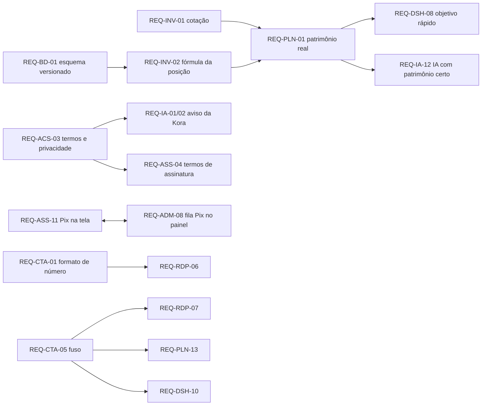

# Consolidação · 03 — O ideal do sistema (requisitos P1)

Os 54 requisitos de prioridade P1 dos 10 pacotes (`<módulo>/10-o-ideal.md`), organizados em **ondas de entrega**. A redação completa de cada requisito, o "como é hoje" e a origem estão no pacote do módulo. P1 = antes de cobrar usuários (inferência do analista; a ajustar pelo negócio).

## Onda 1 — Proteger a receita e o acesso (sem isto, cobrar é arriscado)

| Código | Resumo | Depende de |
|---|---|---|
| REQ-ASS-01 | Conciliação não reativa assinatura em atraso; só pagamento aprovado encerra o atraso | CT-ASS-15 |
| REQ-ASS-02 | Publicar o webhook sem verificação de token e confirmar recebimento real | CT-ASS-20 |
| REQ-ASS-03 | Mostrar valor em reais, cotação e data antes do checkout; recalcular a cada renovação (decisão de 2026-10-13) | — |
| REQ-ASS-11 | "Pagar por Pix" na tela de cobrança, com instruções e aviso de pagamento (decisão de 2026-10-13) | REQ-ADM-08 |
| REQ-ADM-08 | Fila de pagamentos Pix no painel: confirmar/recusar, período pago, valor | REQ-ASS-11 |
| REQ-ASS-04 | Termos de assinatura publicados e aceitos antes do checkout | REQ-ACS-03 |
| REQ-ASS-12 | Migração das tabelas de pagamento versionada | REQ-BD-01 |
| REQ-IA-04 | Função de IA recusa usuário BLOCKED | decisão REQ-BD-05 |
| REQ-BD-04 | Toda edge function com chave de servidor valida usuário e workspace (checklist) | — |

## Onda 2 — Números certos (o produto deve calcular o que promete)

| Código | Resumo | Depende de |
|---|---|---|
| REQ-PLN-01 | Patrimônio = saldo **atual** das contas + posições avaliadas, convertido para a moeda principal | REQ-INV-01, 02 |
| REQ-DSH-08 | Objetivo rápido com o mesmo patrimônio e previsão do Planejamento | REQ-PLN-01, 02 |
| REQ-IA-12 | Ferramentas da IA com o mesmo patrimônio corrigido; capacidade pelos meses com dados | REQ-PLN-01, 03 |
| REQ-PLN-02 | Prazo = data inicial + anos − hoje; mesma data no dashboard e no Planejamento | — |
| REQ-PLN-03 | Uma definição de capacidade (média dos meses com dados; mínimo para aconselhar) | — |
| REQ-PLN-05 | Converter ou avisar sobre valores em moeda diferente da principal | — |
| REQ-DSH-01 | Uma definição de cada número (receitas = recebidas; despesas = pagas; investimentos = aportes) para dashboard, Visão gerencial e Planejamento | decisão "ajustes e resgates" |
| REQ-DSH-02 | Evolução do patrimônio na mesma base do patrimônio atual, com foto mensal automática | decisão REQ-INV-04 |
| REQ-DSH-03 | Erro de consulta visível; nunca totais incompletos como completos | — |
| REQ-INV-01 | Meio de informar a cotação (manual; depois integração); posição sai de "Aguardando cotação" | — |
| REQ-INV-02 | Visão `investment_positions` versionada com a fórmula documentada | T-BD-01, CT-INV-20 |
| REQ-CTA-01 | Valores digitados lidos corretamente em qualquer padrão regional | — |
| REQ-RDP-06 | Idem para despesas | REQ-CTA-01 |
| REQ-RDP-03 | Cada valor na sua moeda; totais separados por moeda; nunca somar moedas diferentes | — |
| REQ-CTA-05 | Datas e limites do mês no fuso do usuário | — |
| REQ-RDP-07, REQ-PLN-13, REQ-DSH-10 | Idem para receitas/despesas, planejamento e dashboard | REQ-CTA-05 |

## Onda 3 — Barreiras no banco, não só na tela

| Código | Resumo | Depende de |
|---|---|---|
| REQ-CTA-02 | Banco impede trocar a moeda de conta com movimentos | — |
| REQ-CTA-11 | Versionar `validate_transfer_accounts` e cobrir com teste de API | T-BD-01 |
| REQ-RDP-02 | Despesa usa a moeda da conta; banco exige a mesma moeda | — |
| REQ-INV-03 | RPCs de alterar/excluir lançamento versionadas, verificando workspace e mês fechado | — |
| REQ-INV-04 | Tela de fechamento de período (ou definir fechamento administrativo) | decisão de produto |
| REQ-INV-08 | Investimento com lançamentos não muda tipo nem moeda nem é excluído; "arquivar" | — |
| REQ-BD-01 | Repositório reconstrói o esquema do zero (baseline gerada do banco) | T-BD-01 |
| REQ-BD-02 | Nenhuma alteração no banco sem migração versionada | REQ-BD-01 |

## Onda 4 — Cadastro básico e vocabulário

| Código | Resumo | Depende de |
|---|---|---|
| REQ-RDP-01 | Todo workspace nasce com categorias padrão e tem tela para gerir as suas | CT-RDP-01 |
| REQ-RDP-04 | Um vocabulário de moeda (ISO), frequência e status; migrar dados | — |
| REQ-CTA-06 | Um vocabulário de tipo de conta e moeda entre assistente, telas e banco; migrar | — |
| REQ-RDP-05 | Assistente cria a primeira receita vinculada à primeira conta, com data | REQ-CTA-06 |
| REQ-CTA-04 | Editar e excluir (ou cancelar) transferência, com privilégio e política coerentes | decisão de produto |

## Onda 5 — Legal e privacidade

| Código | Resumo | Depende de |
|---|---|---|
| REQ-ACS-03 | Termos de Uso e Política de Privacidade publicados, com aceite registrado (usuário, data, versão) | — |
| REQ-IA-01 | Aviso no painel da Kora: dados vão a fornecedor de IA no exterior; não digitar dados pessoais | REQ-ACS-03 |
| REQ-IA-02 | Política cita o operador, finalidade, transferência internacional e retenção; aceite registrado | REQ-ACS-03 |
| REQ-IA-03 | Ressalva "estimativa, não recomendação de investimento" no painel e no prompt | — |
| REQ-IA-05 | Logout apaga a conversa; botão "Limpar conversa" | — |
| REQ-PLN-11 | Remover nome de pessoa real do código | — |
| REQ-ACS-01 | Fluxo "Esqueci minha senha" | — |

## Onda 6 — Operação, auditoria e testes

| Código | Resumo | Depende de |
|---|---|---|
| REQ-ADM-01 | Trilha de auditoria de toda ação administrativa (antes/depois, motivo) | — |
| REQ-ADM-02 | 2FA para administradores; procedimento para incluir/remover | — |
| REQ-IA-08 | Job de insights: privilégio de DELETE, endereço parametrizado e versionado, registro de execução e alerta | CT-IA-18, 19 |
| REQ-BD-03 | Teste automatizado de privilégios e isolamento antes de cada release, com dois usuários `TESTE` | REQ-BD-01 |
| REQ-ASS-08 | Testes automatizados do ciclo comercial no sandbox | — |
| REQ-INV-05 | Testes automáticos atualizados para o esquema atual e na rotina de release | — |
| REQ-PLN-09 | Testes com valores esperados para todos os cálculos do Planejamento | scripts `etapa4/` |

Contagem: Onda 1 = 9; Onda 2 = 18; Onda 3 = 8; Onda 4 = 5; Onda 5 = 7; Onda 6 = 7; **total 54** (igual ao gerado por `consolidar.py req`).

## Visão de dependências

