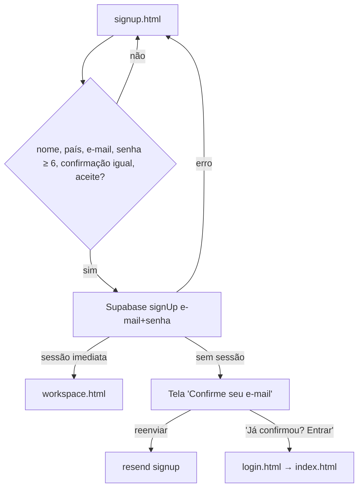
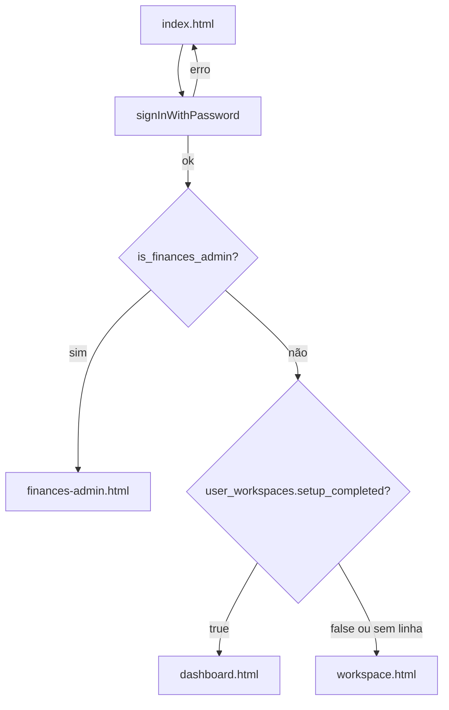
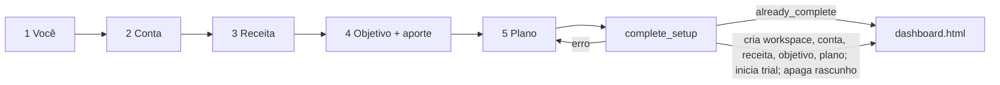

# ACS · 02 — Fluxos

## ACS-F1 — Criar conta

- **Objetivo:** usuário novo cria acesso com e-mail e senha.
- **Escopo:** `signup.html`, `signup.js`, `auth.js:25-28`, Supabase Auth.
- **Etapas:** 1) preenche nome, país, e-mail, senha, confirmação; marca o aceite; 2) validações locais (RN-ACS-001 a 003); 3) chamada `signUp(email, senha)` com link de confirmação apontando para o endereço de produção (RN-ACS-004, 006); 4) se o servidor devolver sessão imediata → `workspace.html`; senão → tela "Confirme seu e-mail" com botão de reenvio (RN-ACS-005).
- **Telas:** `signup.html` (seções `#signup-view` e `#confirm-view`).
- **Casos de teste:** CT-ACS-01 a 05 (`08-plano-de-testes.md`).
- **Como é hoje vs. como deve ser:** nome e país são digitados mas descartados (RN-ACS-004) → REQ-ACS-02; aceite sem link e sem registro → REQ-ACS-03.

## ACS-F2 — Confirmar e-mail

- **O que o código MOSTRA:** o link de confirmação leva a `https://.../KORbuildFinances/index.html` (`auth.js:19-23`). Ao abrir `index.html` com a sessão criada pelo link, `login.js:64-73` detecta a sessão e aplica o roteamento de ACS-F3.
- **Inferência:** o projeto Supabase exige confirmação de e-mail (porque `signup.js:78-82` trata o caso "sem sessão" como normal). **A confirmar no teste.**
- **Ponto para validar:** no ambiente de teste, o link aponta para o site de produção.

## ACS-F3 — Entrar e rotear

- **Escopo:** `index.html`, `login.js`, `auth.js:14`.
- **Etapas:** 1) e-mail + senha; 2) `signInWithPassword`; 3) `is_finances_admin` → se administrador, `finances-admin.html`; 4) senão lê `user_workspaces.setup_completed` → `dashboard.html` (concluído) ou `workspace.html` (pendente ou sem workspace) (RN-ACS-008).
- **Erros:** mensagem do servidor exibida em `#login-message`; botão reabilitado (`login.js:56-61`).
- **Auto-redirecionamento:** já logado ao abrir `index.html` → mesmo roteamento (RN-ACS-009).

## ACS-F4 — Assistente de configuração inicial (onboarding)

- **Objetivo:** criar o contexto mínimo (workspace, 1ª conta, 1ª receita, objetivo, plano) numa única transação.
- **Escopo:** `workspace.html`, `app.js`, RPC `complete_setup`.
- **Pré-condição:** sessão válida (`app.js:181-182`); se `setup_completed` já for true → `dashboard.html` (`app.js:190`).
- **Etapas:**
  1. **Você:** nome, país, moeda principal (USD, EUR, GBP, BRL).
  2. **Primeira conta:** nome, tipo, moeda, saldo atual ≥ 0.
  3. **Primeira receita:** descrição, categoria, valor > 0, frequência (Mensal, Quinzenal, Semanal, Anual, Uma vez), dia de recebimento (1-31, opcional).
  4. **Objetivo:** nome, valor > 0, anos > 0, data inicial, aporte mensal > 0; opção de considerar patrimônio atual; data estimada = data inicial + anos; aviso se aporte > 75% da receita mensal.
  5. **Plano:** resumo; botão "Começar minha jornada".
- **Rascunho:** cada alteração grava no navegador e, 450 ms depois, em `setup_drafts` (um por usuário). Ao reabrir, o rascunho do servidor prevalece (RN-ACS-015/016).
- **Conclusão:** `complete_setup` valida tudo de novo no servidor, cria os 5 registros, inicia o teste grátis, marca `setup_completed` e apaga o rascunho (RN-ACS-020 a 023). Mensagem de sucesso em `alert` e vai para `dashboard.html` (`app.js:154`).
- **Telas:** `workspace.html` seções `data-step` 1 a 5.
- **Casos de teste:** CT-ACS-10 a 20.

## ACS-F5 — Revisão pós-configuração

- **Entrada:** `settings.html` (menu mobile "Perfil", link "Configurar planejamento") → `workspace.html?mode=review` (RN-ACS-029).
- **Pré-condição:** `setup_completed = true`; senão alerta e volta ao dashboard (`app.js:185, 194`).
- **O que mostra:** 5 cartões (Você, Primeira conta, Primeira receita, Objetivo, Plano) com dados reais (`app.js:67-81`).
- **Edições:** Você → etapa 1, grava em `user_workspaces` (`app.js:88-100`); Objetivo e Plano → etapa 4, grava `goals` e `plans` juntos (`app.js:101-119`); Conta e Receita → telas `account-edit.html` / `income-edit.html` com `return=review` (`app.js:71, 74`). "Voltar" descarta alterações não salvas (`app.js:174`).
- **Inferência:** "primeira conta" = conta mais antiga; "primeira receita" = receita mais antiga; objetivo e plano = os mais recentes (`app.js:47-50`).

## ACS-F6 — Sessão, guarda de acesso comercial e saída

- **Sessão:** toda verificação chama `getSession` e depois `getUser` no servidor; usuário inexistente ou token inválido → logout e tratado como "sem sessão" (`auth.js:3-13`).
- **Sem sessão:** cada tela redireciona para `index.html` (maioria) ou `login.html` (`workspace.html:26`, `app.js:182`, `auth.js:247`), que por sua vez vai a `index.html`.
- **Guarda comercial:** em todas as telas exceto `index`, `signup`, `workspace`, `billing`, `finances-admin`, chama `get_workspace_access_status`; se `access = 'BLOCKED'` → `billing.html`. Falha técnica não bloqueia (`auth.js:38-62`).
- **Sair:** limpa rascunho local e marca de onboarding, `signOut` (`auth.js:29-33`); botão "Sair" existe em `workspace.html:6` e nas telas de produto.
