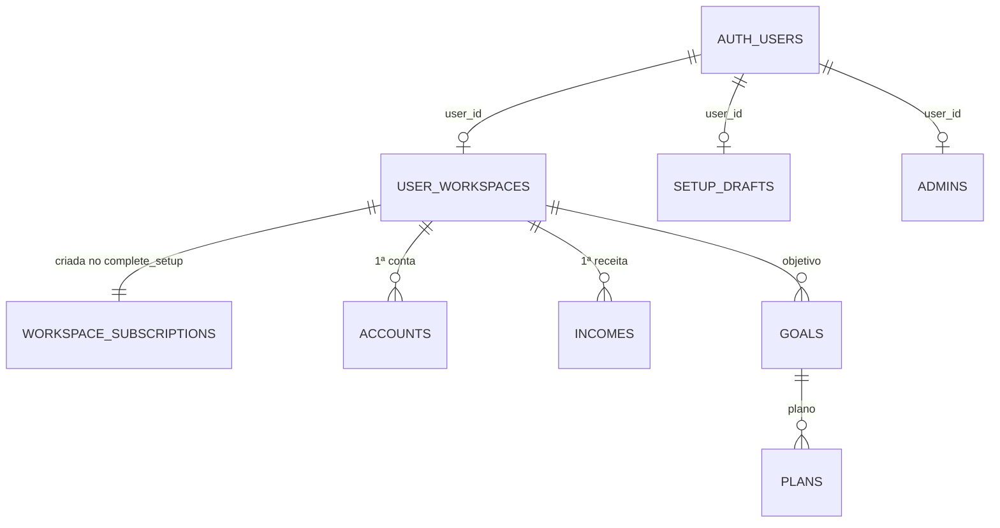

# ACS · 06 — Modelo de dados do módulo

Só colunas que o código MOSTRA. Tipos são inferidos do uso. Lista completa: Ponto para validar com T-BD-01.

## `finances.user_workspaces` (um por usuário)

| Coluna | Tipo (inferido) | Uso | Fonte |
|---|---|---|---|
| `id` | uuid | chave; referenciado por todas as tabelas financeiras | `20260914160000:13` |
| `user_id` | uuid → `auth.users` | dono | `login.js:28`; SQL `:77` |
| `display_name` | text | nome exibido ("Olá, …") | SQL `:81-82`; `app.js:93` |
| `country` | text | país de residência | idem |
| `primary_currency` | text ("USD — Dólar americano" ou código) | moeda principal | idem; normalização em `app.js:20` |
| `setup_completed` | boolean | configuração concluída | SQL `:100`; `login.js:27` |
| `created_at` | timestamptz | inferido | — |

Restrições inferidas: `user_id` único (uma linha por usuário: `maybeSingle` em `login.js:29`). **Ponto para validar.**

## `finances.setup_drafts` (rascunho do assistente)

| Coluna | Tipo | Uso | Fonte |
|---|---|---|---|
| `user_id` | uuid (único, `onConflict`) | dono | `app.js:26` |
| `current_step` | integer 1-5 | etapa atual | idem |
| `data` | jsonb | todos os campos do assistente (chaves em `app.js:24`) | idem |

Ciclo de vida: criado/atualizado durante o assistente; apagado em `complete_setup` (SQL `:101`). Privilégios: S/I/U para `authenticated` (`20260928000000:26`).

## `finances.admins`

| Coluna | Tipo | Fonte |
|---|---|---|
| `user_id` | uuid PK → `auth.users` | `20260915190000:22` |
| `active` | boolean default true | `:23` |
| `created_at` | timestamptz | `:24` |

## Conteúdo do `payload` de `complete_setup` (contrato tela → banco)

| Chave | Origem na tela | Validação no servidor | Destino |
|---|---|---|---|
| `name`, `country`, `currency` | etapa 1 | obrigatórios (`:54`) | `user_workspaces` |
| `account`, `accountType`, `accountCurrency`, `balance` | etapa 2 | obrigatórios; `balance` numérico ≥ 0 (`:55, 57, 74`) | `accounts` (`opening_balance = GREATEST(0, balance)`) |
| `incomeDesc`, `incomeCategory`, `income`, `frequency`, `incomeDay` | etapa 3 | obrigatórios; `income` > 0 (`:56, 58, 69`) | `incomes` (moeda = `currency`; `receipt_day`; sem `account_id`) |
| `goalName`, `goalTarget`, `goalYears`, `startDate`, `includeInitial`, `initial` | etapa 4 | meta > 0; 1 ≤ anos ≤ 100; data válida; inicial ≥ 0 (`:59-62, 70-73`) | `goals` |
| `monthlyContribution` | etapa 4 | numérico > 0 (`:61, 72`) | `plans.projected_monthly_contribution`; `projected_monthly_rate = 0` |

Retorno: `{workspace_id, goal_id, already_complete}` (SQL `:78, 102`).

## Diagrama

