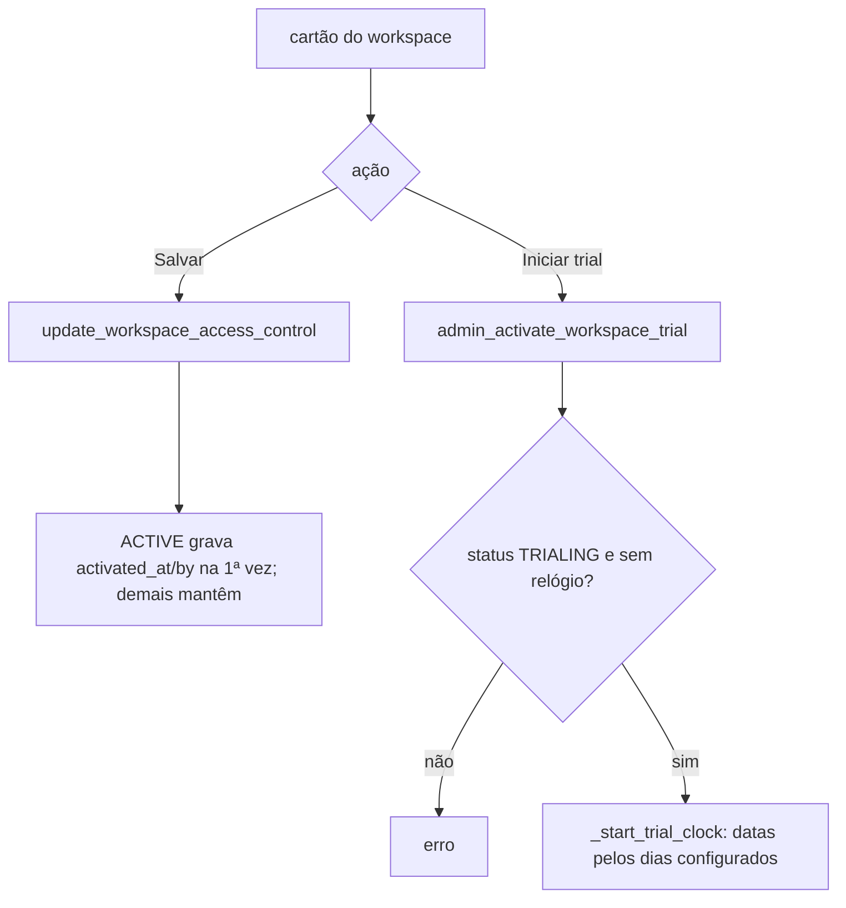

# ADM · 02 — Fluxos

## ADM-F1 — Entrar no painel

`login.js:18-23` leva o administrador direto a `finances-admin.html`; a tela confere `is_finances_admin` e manda os demais ao dashboard (`finances-admin.js:248-253`). Seis blocos carregam em paralelo (`:256`); erro em um bloco mostra mensagem genérica no rodapé.

## ADM-F2 — Limites de IA por workspace

Lista todos os workspaces com limite mensal (padrão 100), habilitado (padrão sim) e uso no mês (chamadas com sucesso desde o 1º dia do mês UTC). Alerta quando uso ≥ 80 % do limite (ou qualquer uso se limite 0). Salvar grava limite ≥ 0 e habilitado (`finances-admin.js:24-74`; `20260915190000_...:46-106`).

## ADM-F3 — Preço padrão e configuração de trial

- Preço: valor mensal (> 0 ou vazio = manter) e moeda USD/EUR/BRL; a tela sempre envia `monthly_price_brl` nulo (`finances-admin.js:84-94`).
- Trial: dias de teste (≥ 1) e dias de carência (≥ 0); valem só para relógios iniciados depois (`finances-admin.js:130-140`; `20260916130000_...:53-87`).

## ADM-F4 — Ajuste de preço por workspace

Percentual (positivo ou negativo, sem limite) e observação por workspace (`finances-admin.js:142-173`). Efeito: preço exibido e valor cobrado (ASS).

## ADM-F5 — Controle de acesso por workspace

Cartão por workspace: status efetivo (calculado), status administrativo (TRIALING, ACTIVE, SUSPENDED, CANCELLED), trial habilitado, origem e motivo da ativação, datas do trial; botão "Iniciar trial" só quando TRIALING sem relógio (`finances-admin.js:175-246`).

## ADM-F6 — Instruções de pagamento manual

Método (PIX, transferência, outro), titular, chave Pix, banco, contato, texto (`finances-admin.js:96-120`). Gravadas na linha única `payment_instructions`; expostas ao usuário pela RPC `get_own_payment_instructions`, que **nenhuma tela chama** (ASS). Não há fluxo de confirmação de pagamento manual.
