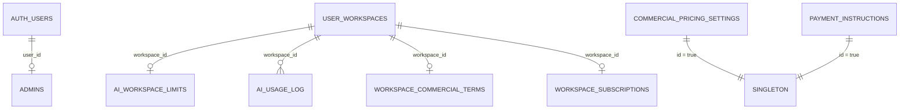

# ADM · 06 — Modelo de dados do módulo

| Tabela | Colunas conhecidas | DDL no repositório? | Fonte |
|---|---|---|---|
| `admins` | `user_id` (PK → `auth.users`), `active`, `created_at` | sim | `20260915190000_...:21-25` |
| `ai_workspace_limits` | `workspace_id` (único), `monthly_request_limit`, `enabled`, `updated_by`, `updated_at` | não | `20260915190000_...:98-104` |
| `commercial_pricing_settings` | `id` (true), `monthly_price`, `currency`, `monthly_price_brl`, `trial_days`, `grace_days`, `payment_grace_days`, `updated_by`, `updated_at` | parcial (2 colunas) | `20260916130000_...:18-19`; `20260925000000_...` |
| `workspace_commercial_terms` | `workspace_id` (único), `price_adjustment_percent`, `notes`, `created_by`, `updated_by`, `updated_at` | não | `20260915230000_...:182-191` |
| `workspace_subscriptions` | ver ASS | sim | `20260915210000_...` |
| `payment_instructions` | `id` (true), `method`, `account_holder`, `pix_key`, `bank_name`, `payment_contact`, `instructions`, `updated_by`, `updated_at` | não | `20260915230000_...:125-137` |
| `ai_usage_log` (leitura) | `workspace_id`, `status`, `created_at` | sim | `20260914160000_...` |

