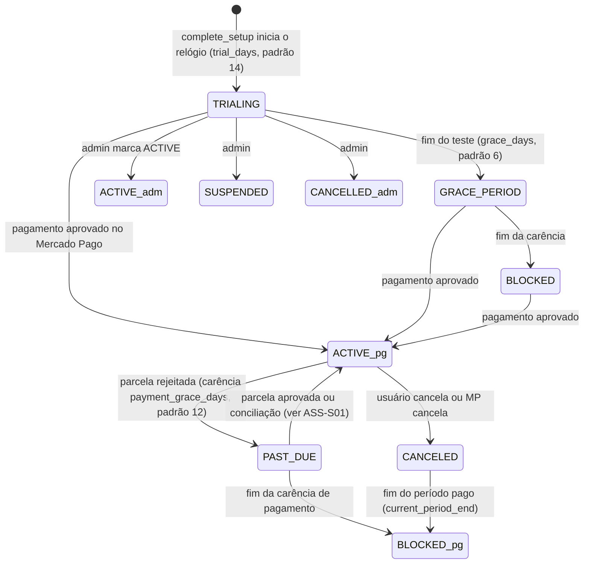
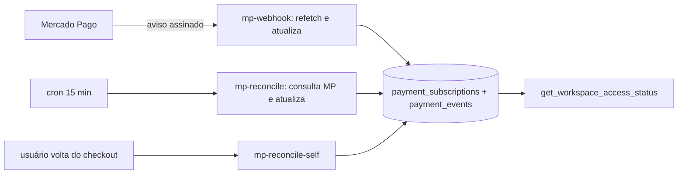

# ASS · 02 — Fluxos

## ASS-F1 — Ciclo de acesso de um workspace

Estados devolvidos por `get_workspace_access_status` (`20260925000000_...:62-157`), conferidos em `homologacao/scripts/etapa6/status-de-acesso.py`:



Exemplo conferido (teste iniciado em 2026-10-01 10:00 UTC, 14 + 6 dias): dia 13 → "1 dia restante"; dia 14 às 10:00 → carência com 6 dias; dia 20 às 10:00 → bloqueado. Pagamento em atraso desde 01/10 com 12 dias: bloqueio em 13/10 às 10:00.

**Precedência** (RN-ASS-002): se existir linha em `payment_subscriptions` com `active`, `past_due` ou `canceled`, ela decide; `pending` e `paused` caem no fluxo de teste. Pagamento ativo vence até um `SUSPENDED` administrativo.

## ASS-F2 — Assinar (checkout)

- **Escopo:** `billing.js:77-118`, `mp-create-subscription/index.ts`.
- **Etapas:** 1) botão "Assinar com Mercado Pago" (qualquer status exceto ACTIVE); 2) a função valida o usuário e acha o workspace; 3) se já `active`/`past_due` → "Já existe uma assinatura"; se `pending` com assinatura no MP, consulta o MP: autorizada → "já existe"; pendente → reaproveita o link de pagamento; cancelada/rejeitada → cria nova; 4) lê o preço base e a moeda; se não for BRL, converte pela PTAX mais recente (erro se não houver cotação); aplica o ajuste do workspace; arredonda ao centavo; 5) cria a assinatura recorrente mensal em BRL no MP (referência = id do workspace, e-mail do usuário, retorno para `billing.html?mp_return=1`, aviso para `mp-webhook`); 6) grava `payment_subscriptions` como `pending` e um evento; 7) redireciona o usuário ao MP.
- **Regras:** RN-ASS-007 a 010. **Casos:** CT-ASS-05 a 12.

```mermaid
flowchart TD
  A[billing.html: Assinar] --> B[mp-create-subscription]
  B --> C{assinatura local?}
  C -- active/past_due --> X[409 já assinado]
  C -- pending com id MP --> D{status no MP?}
  D -- authorized --> X
  D -- pending --> E[reaproveita link]
  D -- outro --> F
  C -- nenhuma --> F[preço base × PTAX × (1+ajuste) → R$]
  F -- sem cotação --> Y[503 cotação indisponível]
  F --> G[POST preapproval mensal em BRL]
  G -- erro --> Z[evento subscription_create_failed]
  G --> H[payment_subscriptions = pending; evento] --> I[redireciona ao Mercado Pago]
```

## ASS-F3 — Confirmação e atualização de status (webhook e conciliação)

- **Webhook** (`mp-webhook/index.ts`): exige `MP_WEBHOOK_SECRET`; valida `x-signature`/`x-request-id` (HMAC); **nunca confia no corpo**: reconsulta o recurso no MP. Tópico `payment`: aprovado → `active` (+ fim do período = próxima cobrança; não ressuscita `canceled`); rejeitado → `past_due` na primeira vez. Tópico `preapproval`: `authorized` com local `pending` → `active`; `cancelled` → `canceled` (mantém fim do período); `paused` → `paused`. Tudo registrado em `payment_events`; aviso sem dono vira evento `unresolved_workspace`.
- **Conciliação em lote** (`mp-reconcile/index.ts`): a cada 15 min, para cada assinatura `pending`/`active`/`past_due`/`paused` com id no MP e sem atualização há 15 min, consulta o MP: `authorized` e local ≠ `active` → vira `active` **e zera `past_due_since`**; `cancelled` → `canceled`; `paused` → `paused`. Sem bloqueio contra execuções simultâneas (escritas idempotentes).
- **Conciliação própria** (`mp-reconcile-self`): mesma lógica, para o workspace do usuário, chamada por `billing.js:277-287` ao voltar do checkout (`?mp_return=1`).



## ASS-F4 — Cancelar

`billing.js:199-245` → `mp-cancel-subscription`: só com assinatura `active` ou `past_due` (cartão "Gerenciar"); confirmação; PUT `cancelled` no MP; local `canceled` + `cancel_requested_at`; acesso continua até `current_period_end` (se estiver preenchido; se nulo, o acesso cai na hora: ASS-S05).

## ASS-F5 — Cotação PTAX

`mp-sync-exchange-rate`: por job (não versionado), busca a cotação de venda de USD e EUR no Banco Central para hoje; se não houver (fim de semana, feriado), recua até 7 dias; grava por moeda e data da cotação. Conferido em `scripts/etapa6/ptax-dias-sem-cotacao.py`. GBP não é sincronizado.

## ASS-F6 — Tela de assinatura

`billing.js:144-187` mostra um cartão por status (ACTIVE, TRIALING, GRACE_PERIOD, SUSPENDED/CANCELLED, PAST_DUE, CANCELED, BLOCKED, TRIAL_DISABLED, SETUP_REQUIRED/NO_WORKSPACE, desconhecido); preço pela `get_own_commercial_price` na moeda base com nota do ajuste; cartão de pagamento para qualquer status ≠ ACTIVE; cartão "Gerenciar" só ACTIVE/PAST_DUE.
