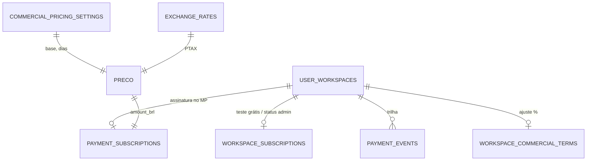

# ASS · 06 — Modelo de dados do módulo

## `finances.workspace_subscriptions` (DDL em `20260915210000_...:15-29`)

| Coluna | Tipo | Regra |
|---|---|---|
| `workspace_id` | uuid PK → `user_workspaces` (cascata) | |
| `status` | text: `TRIALING` (padrão), `ACTIVE`, `SUSPENDED`, `CANCELLED` | CHECK |
| `trial_enabled` | boolean, padrão true | |
| `trial_started_at`, `trial_ends_at`, `grace_ends_at` | timestamptz | `trial_ends_at ≥ trial_started_at` (CHECK) |
| `activation_source` | `TRIAL`, `MANUAL`, `OTHER` ou nulo | CHECK |
| `activation_reason`, `activated_at`, `activated_by` | text, timestamptz, uuid → `auth.users` | |
| `created_at`, `updated_at` | timestamptz | |

## `finances.payment_subscriptions` (DDL fora do repositório; colunas pelo uso)

| Coluna | Tipo (inferido) | Uso | Fonte |
|---|---|---|---|
| `workspace_id` | uuid, único (upsert `onConflict`) | | `mp-create-subscription/index.ts:193-202` |
| `status` | `pending`, `active`, `past_due`, `canceled`, `paused` (e `trial` citado no SQL) | | `20260925000000_...:108` |
| `mp_preapproval_id`, `mp_payer_id` | text | ids no MP | |
| `amount_brl` | numeric | valor cobrado | |
| `current_period_start`, `current_period_end` | timestamptz | período pago | |
| `past_due_since` | timestamptz | início do atraso | |
| `cancel_requested_at` | timestamptz | | |
| `updated_at` | timestamptz | base da conciliação em lote | |

## `finances.payment_events` (DDL fora do repositório)

Colunas usadas: `workspace_id` (nulo quando não resolvido), `mp_preapproval_id`, `mp_payment_id`, `event_type`, `raw_payload` (jsonb), `error_message`, `processed_at`. Tipos de evento: `subscription_created`, `subscription_reused`, `subscription_create_failed`, `subscription_cancel_requested`, `subscription_cancel_failed`, `subscription_reconciled`, `payment_<status>`, `payment_fetch_failed`, `preapproval_<status>`, `preapproval_fetch_failed`, `unresolved_workspace`, `unhandled_topic_<tópico>`.

## `finances.commercial_pricing_settings` (linha única, `id = true`)

`monthly_price`, `currency` (USD/EUR/BRL), `monthly_price_brl` (sem uso), `trial_days` (>0, padrão 14), `grace_days` (≥0, padrão 6), `payment_grace_days` (≥0, padrão 12 quando nulo), `updated_by`, `updated_at`.

## `finances.exchange_rates`

`currency` (USD, EUR), `rate_to_brl`, `rate_date` (único com a moeda), `created_at`.

