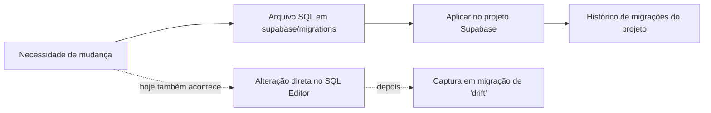

# BD · 02 — Fluxos operacionais do banco

O módulo BD não tem telas. Os "fluxos" aqui são os processos que acontecem dentro do banco ou em volta dele.

## Fluxo BD-F1 — Aplicar uma mudança no banco (release)

- **Objetivo:** levar uma alteração de estrutura ou função ao banco de forma controlada.
- **Escopo:** desenvolvedor + projeto Supabase.
- **Como é hoje (o que os documentos MOSTRAM):** a regra operacional diz que "produção é a linha de base; toda mudança futura deve estar numa migração versionada antes de contar como histórico controlado" (`docs/PROD_DATABASE_MIGRATION_BASELINE_2026-09-24.md`, seção "Operational rule"). Na prática, várias funções foram criadas direto no banco e capturadas depois (`supabase/migrations/20260925000000_capture_live_function_drift.sql:11-18`).
- **Etapas (inferidas):** 1) escrever o SQL em `supabase/migrations/<timestamp>_<nome>.sql`; 2) aplicar com a CLI do Supabase; 3) o banco registra o nome na tabela de histórico.
- **Ponto para validar:** não há pipeline automático (nenhum workflow em `.github/`); quem aplica, quando e como se registra a aprovação.



## Fluxo BD-F2 — Agendamentos (cron)

| Nome do job | Frequência | O que faz | Fonte |
|---|---|---|---|
| `daily-ai-insights` | todo dia 06:00 UTC | chama a edge function `compute-insights` com o cabeçalho `x-cron-secret` lido do Vault (`cron_secret`) | `supabase/migrations/20260914233500_ai_insights_daily_schedule.sql:17-30` |
| `mp-reconcile-15min` | a cada 15 min | chama `mp-reconcile` com `dry_run=false`; URL e segredo lidos do Vault (`project_url`, `finances_reconcile_cron_secret`) | `supabase/migrations/20260926000000_mp_reconcile_cron.sql:18-32` |
| `daily-exchange-rate-sync` | **não versionado** | sincroniza cotação PTAX (edge function `mp-sync-exchange-rate`) | citado em `20260926000000_mp_reconcile_cron.sql:8-10` |

Pré-requisito manual: o operador grava os segredos no Vault e nas variáveis das edge functions (`20260926000000_mp_reconcile_cron.sql:12-16`). **Ponto para validar:** quem guarda esses valores e como são rotacionados.

## Fluxo BD-F3 — Conclusão da configuração inicial (transação atômica)

Executado pela função `finances.complete_setup` (versão atual em `supabase/migrations/20260927120000_complete_setup_user_declared_contribution.sql`). Descrito em detalhe no módulo ACS (`homologacao/ACS/02-fluxos.md`, fluxo ACS-F4). Aqui importa o padrão: bloqueio por usuário (`pg_advisory_xact_lock`, linha 76), leitura com `FOR UPDATE` (linha 77) e tudo ou nada numa única transação.

## Fluxo BD-F4 — Cálculo de saldo de conta (visão `account_balances`)

Regra em `supabase/migrations/20260912010000_package_1_financial_integrity.sql:139-148`:

```
saldo atual = saldo inicial
  + receitas realizadas vinculadas à conta
  - despesas realizadas vinculadas à conta
  - transferências que saem da conta (valor de origem)
  + transferências que entram na conta (valor de destino)
  - aportes e taxas de investimento pagos pela conta
  + resgates e rendimentos de investimento recebidos na conta
```

Detalhado e testado no módulo CTA (Etapa 2).

## Casos de teste do módulo

Ver `08-plano-de-testes.md`.
