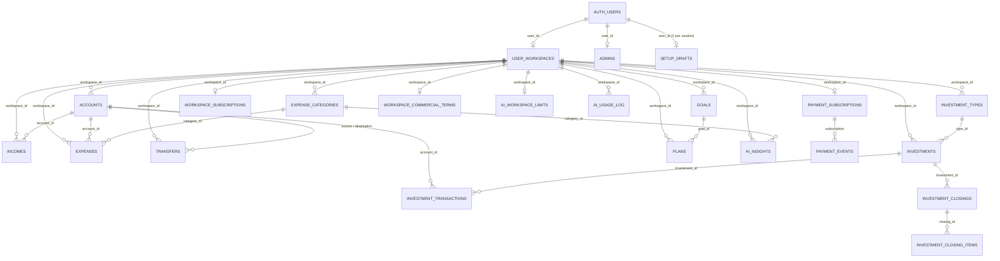

# BD · 06 — Modelo de dados (visão geral do esquema `finances`)

Fonte: colunas citadas nas migrações, nas funções SQL, nas edge functions e nos JS das telas. Só 4 tabelas têm `CREATE TABLE` no repositório; as demais são **inferidas** pelas colunas usadas no código. A lista completa de colunas de cada tabela só pode ser confirmada no banco de teste (Ponto para validar em cada módulo).

## 1. Grupos e relacionamentos

Relações marcadas com nomes de colunas são as que o código MOSTRA (ex.: `ai_insights.category_id references expense_categories(id)`, `20260914233000:16`). As demais são inferidas pelos nomes.

## 2. Tabelas por grupo

| Grupo | Tabela | DDL no repositório? | Colunas conhecidas (fonte) | Módulo responsável |
|---|---|---|---|---|
| Usuário | `user_workspaces` | não | `id, user_id, display_name, country, primary_currency, setup_completed` (`20260927120000:81-82`; `app.js:28`) | ACS |
| Usuário | `setup_drafts` | não | `user_id` (único), `current_step`, `data jsonb` (`app.js:26-27`) | ACS |
| Usuário | `admins` | sim | `user_id, active, created_at` (`20260915190000:21-25`) | ADM |
| Finanças | `accounts` | não | `id, workspace_id, name, account_type, currency, opening_balance, created_at` (`20260927120000:88-89`; `app.js:47`) | CTA |
| Finanças | `transfers` | não | `id, workspace_id, source_account_id, destination_account_id, source_amount, destination_amount, source_currency, destination_currency` (`20260913120000`; `20260912010000:143-144`) | CTA |
| Finanças | `incomes` | não | `id, workspace_id, description, category, amount, currency, frequency, receipt_day, account_id, receipt_date, status, created_at` (`20260927120000:91-92`; `tests/workspace-review.spec.js:30`) | RDP |
| Finanças | `expenses` | não | `id, workspace_id, amount, currency, status, paid_date, category_id, account_id` (`20260914233000:60-72`; `20260912010000:142`) | RDP |
| Finanças | `expense_categories` | não | `id, workspace_id, name` (`tests/helpers/db.js:56`) | RDP |
| Investimentos | `investment_types` | não | `id, workspace_id, ...` | INV |
| Investimentos | `investments` | não | `id, workspace_id, expected_monthly_rate (obrigatória), updated_at` (`20260927150000:6-7`) | INV |
| Investimentos | `investment_transactions` | não | `id, workspace_id, investment_id, account_id, transaction_type, amount, currency, ...` (`20260912010000:106-132`) | INV |
| Investimentos | `investment_closings`, `investment_closing_items` | não | só nomes (`20260928000000:24-25`) | INV |
| Planejamento | `goals` | não | `id, workspace_id, name, target_amount, target_years, start_date, include_initial_wealth, initial_wealth, created_at` (`20260927120000:94-95`) | PLN |
| Planejamento | `plans` | não | `id, workspace_id, goal_id, projected_monthly_contribution, projected_monthly_rate, created_at` (`20260927120000:97-98`) | PLN |
| Comercial | `workspace_subscriptions` | sim | DDL completa em `20260915210000:15-29` | ASS |
| Comercial | `commercial_pricing_settings` | não | `id (true), monthly_price, currency, monthly_price_brl, trial_days, grace_days, payment_grace_days, updated_by, updated_at` (`20260925000000:43-48`; `20260916130000:18-19`; `:273`) | ASS/ADM |
| Comercial | `workspace_commercial_terms` | não | `workspace_id, price_adjustment_percent, notes, created_by, updated_by, updated_at` (`20260915230000:182-184`) | ADM |
| Comercial | `payment_instructions` | não | `id (true), method, account_holder, pix_key, bank_name, payment_contact, instructions, updated_by, updated_at` (`20260915230000:125-128`) | ADM |
| Comercial | `payment_subscriptions` | não | `workspace_id, status ('active','past_due','canceled','trial','pending','paused'), amount_brl, current_period_start, current_period_end, past_due_since, cancel_requested_at` (`20260925000000:86-110, 230-238`) | ASS |
| Comercial | `payment_events` | não | só nome (edge functions `mp-*`) | ASS |
| Comercial | `exchange_rates` | não | `currency, rate_to_brl, rate_date` (`20260925000000:205-212`) | ASS |
| IA | `ai_usage_log` | sim | DDL em `20260914160000:11-22` | IA |
| IA | `ai_insights` | sim | DDL em `20260914233000:12-21` | IA |
| IA | `ai_workspace_limits` | não | `workspace_id, monthly_request_limit, enabled, updated_by, updated_at` (`20260915190000:98-104`) | IA/ADM |

Total: 25 tabelas identificadas; produção declara 27. **Ponto para validar:** quais são as 2 restantes (candidatas: alguma tabela de `crypto_assets`, pois existe a função `set_crypto_assets_updated_at` em `20260923191000:7`).

## 3. Visões

| Visão | DDL no repositório? | `security_invoker` | Usada por |
|---|---|---|---|
| `account_balances` | sim (`20260912010000:139-148`) | sim | `accounts.js` |
| `investment_positions` | não | **Ponto para validar** | `dashboard.js`, `planning.js`, `investments.js`, `investment-detail.js`, edge function `finances-ai` |
| `financial_cash_flow` | não | sim (`20260928030000:11`) | nenhuma tela (sem grant a `authenticated`) |
| `net_worth_by_currency` | não | sim (`20260928030000:12`) | nenhuma tela |

## 4. Restrições e gatilhos conhecidos

| Objeto | Tipo | Regra | Fonte |
|---|---|---|---|
| `transfers_same_currency_amounts_match` | CHECK | RN-BD-007 | `20260913120000:13-18` |
| `expenses_amount_check` | CHECK | valor de despesa não negativo | `docs/security-diagnostic.md`, Fase 3 (não está no repositório) |
| `trg_validate_investment_transaction_account` | gatilho BEFORE INSERT/UPDATE | RN-BD-008 | `20260912010000:135-136` |
| `validate_transfer_accounts` | função de gatilho | **Inferência:** valida contas da transferência | só o nome em `20260923191000:8` |
| `set_*_updated_at` | funções de gatilho | preenchem `updated_at` | `20260923191000:5-9` |
| `commercial_pricing_settings_trial_days_check` / `grace_days_check` | CHECK | `trial_days > 0`, `grace_days >= 0` | `20260916130000:23-28` |
| `workspace_subscriptions` | CHECK | status em 4 valores; `trial_ends_at >= trial_started_at` | `20260915210000:17, 28` |
| moeda da receita = moeda da conta | mensagem de erro do banco | `docs/security-diagnostic.md`, Fase 3 | não está no repositório |
