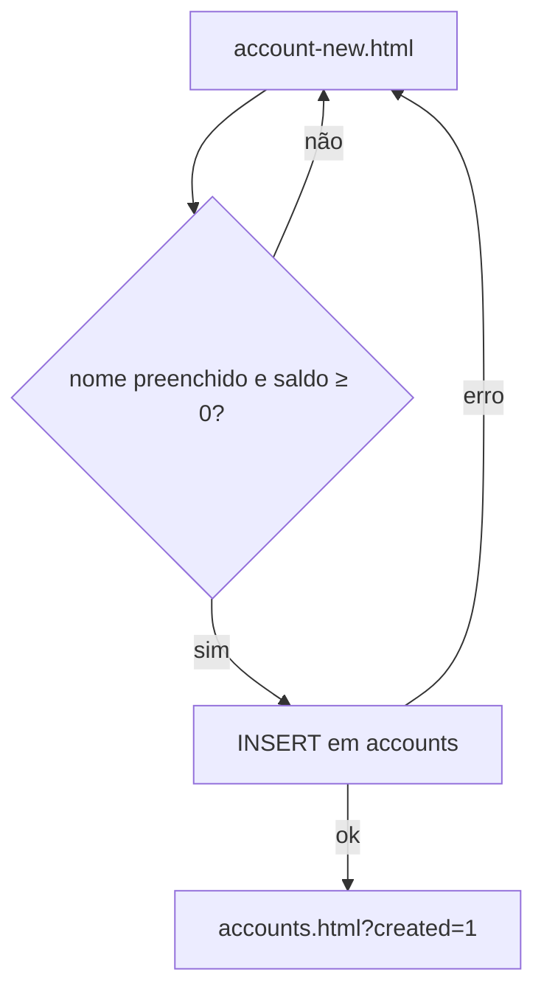
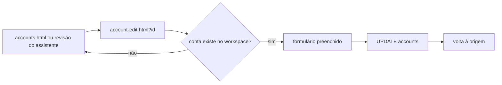
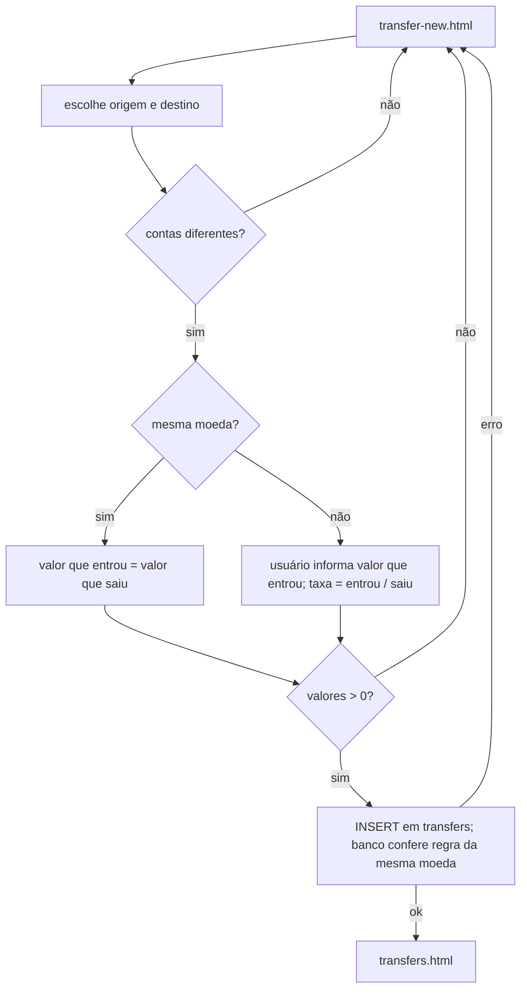

# CTA · 02 — Fluxos

## CTA-F1 — Cadastrar conta

- **Objetivo:** registrar onde o dinheiro está (conta corrente, poupança etc.) e o saldo de partida.
- **Escopo:** `account-new.html`, `account-new.js`.
- **Etapas:** 1) a tela carrega e escolhe como moeda padrão a moeda principal do workspace, se for BRL, USD, EUR ou GBP (RN-CTA-003); 2) usuário informa nome, tipo, moeda, saldo inicial; 3) validações no navegador (RN-CTA-002); 4) grava em `accounts`; 5) volta à lista com "Conta cadastrada com sucesso".
- **Telas:** `account-new.html` → `accounts.html?created=1`.
- **Casos de teste:** CT-CTA-01 a 05.



## CTA-F2 — Editar conta

- **Etapas:** abre por `account-edit.html?id=...`; busca a conta do workspace; preenche o formulário; ao salvar, atualiza nome, tipo, moeda, saldo inicial (RN-CTA-004). Vindo da revisão do assistente, volta para `workspace.html?mode=review`.
- **Ponto de atenção:** o tipo da conta criada pelo assistente tem outro vocabulário (RN-CTA-021). Casos CT-CTA-06 a 09.



## CTA-F3 — Excluir conta

- **Etapas:** botão "Excluir" na lista → confirmação "Esta ação não pode ser desfeita" → `DELETE` em `accounts` filtrado por workspace → mensagem "Conta excluída." ou o texto de erro devolvido pelo banco (RN-CTA-006). Caso CT-CTA-10 a 12.
- **Ponto para validar:** o que o banco faz com receitas, despesas, transferências e lançamentos ligados à conta (bloqueia, apaga junto ou deixa órfãos).

## CTA-F4 — Registrar transferência

- **Objetivo:** mover dinheiro entre duas contas do próprio usuário sem contar como receita nem despesa (texto de `transfers.html`).
- **Escopo:** `transfer-new.html`, `transfer-new.js`.
- **Etapas:** 1) carrega as contas, data de hoje (RN-CTA-014); 2) usuário escolhe origem e destino; a tela compara as moedas; 3) mesma moeda: valor que entrou é copiado do valor que saiu; moedas diferentes: usuário informa o valor que entrou; 4) validações (RN-CTA-009 a 012); 5) grava a taxa de câmbio calculada e as moedas das duas contas; 6) volta à lista.
- **Regras:** RN-CTA-009 a 016, 021.
- **Casos de teste:** CT-CTA-13 a 24.



## CTA-F5 — Editar transferência (rota sem link)

- **O que o código MOSTRA:** `transfer-edit.html?id=...` existe e funciona, mas a lista de transferências não tem link para ela (`transfers.js:8` monta as linhas sem ação). Só abre digitando o endereço (também diz o comentário de `tests/transfers.spec.js:5-10`).
- **Etapas:** carrega a transferência do workspace; preenche contas, valores, data, descrição; ao salvar recalcula a taxa e atualiza a linha (`transfer-edit.js:9`).
- **Não existe exclusão de transferência** em nenhuma tela, e `authenticated` não tem privilégio DELETE (`20260928020000_...:29-32,41`). Caso CT-CTA-22 e 23.

## CTA-F6 — Saldo atual da conta

Fórmula da visão `account_balances` (`20260912010000_...:139-148`), conferida por script (`homologacao/scripts/etapa2/saldo-e-cambio.py`):

```
saldo atual = saldo inicial
  + receitas com status 'realized' ligadas à conta
  − despesas com status 'realized' ligadas à conta
  − transferências que saem (valor de origem)
  + transferências que entram (valor de destino)
  − aportes e taxas de investimento da conta
  + resgates e rendimentos de investimento da conta
```

Exemplo: 1000 + 500 − 200 − 150 + 80 − (100 + 5) + (40 + 7) = **1172,00** (receita planejada, receita cancelada e despesa planejada não entram). A visão soma valores sem olhar a moeda (ver RN-CTA-008).
