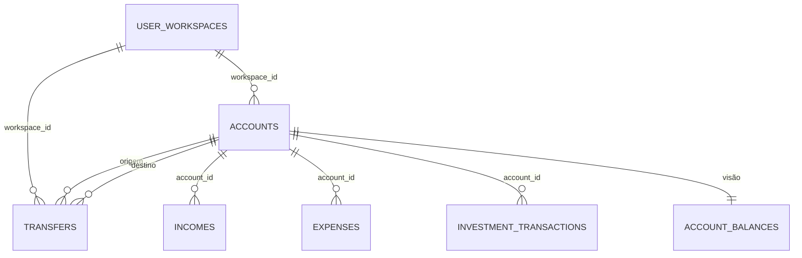

# CTA · 06 — Modelo de dados do módulo

Só colunas que o código MOSTRA. Definição completa: **Ponto para validar** (T-BD-01).

## `finances.accounts`

| Coluna | Tipo (inferido) | Uso | Fonte |
|---|---|---|---|
| `id` | uuid | chave | `account-edit.js:11` |
| `workspace_id` | uuid → `user_workspaces` | dono | `account-new.js:9` |
| `name` | text | nome | idem |
| `account_type` | text | tipo | idem |
| `currency` | text | moeda | idem |
| `opening_balance` | numeric | saldo inicial | idem |
| `created_at` | timestamptz | ordenação | `accounts.js:2` |

**Vocabulário de `account_type` (inconsistente):**

| Origem | Valores gravados |
|---|---|
| Telas de conta | `corrente`, `poupanca`, `investimento`, `digital`, `outro` |
| Assistente inicial | `Conta corrente`, `Poupança`, `Conta digital`, `Dinheiro em espécie`, `Outro` (`workspace.html:9`) |

**Vocabulário de `currency`:** nas contas, código (`BRL`, `USD`…); no workspace e em receitas do assistente, rótulo (`USD — Dólar americano`); em receitas das telas, código. O banco normaliza por `upper(split_part(trim(x),' — ',1))` nas regras que comparam moedas.

## `finances.transfers`

| Coluna | Tipo (inferido) | Uso | Fonte |
|---|---|---|---|
| `id`, `workspace_id` | uuid | chave e dono | `transfer-new.js:7` |
| `source_account_id`, `destination_account_id` | uuid → `accounts` | contas | idem |
| `source_amount`, `destination_amount` | numeric | valor que saiu e que entrou | idem |
| `source_currency`, `destination_currency` | text | moedas copiadas das contas | idem |
| `fx_rate` | numeric, nulo se mesma moeda | entrou ÷ saiu | idem |
| `transfer_date` | date | data | idem |
| `description` | text, nulo | texto livre | idem |
| `created_at`, `updated_at` | timestamptz | ordenação; preenchido por gatilho `set_transfers_updated_at` | `transfers.js:8`; `20260923191000_...:5` |

Restrições conhecidas: `transfers_same_currency_amounts_match` (CHECK); gatilho `validate_transfer_accounts` (conteúdo desconhecido).

## Visão `account_balances`

Colunas: `id, workspace_id, name, account_type, currency, opening_balance, current_balance`. Fórmula em CTA-F6. Usa `security_invoker` (cada usuário só vê o que a RLS permite).

