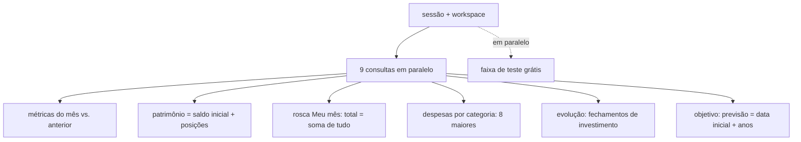
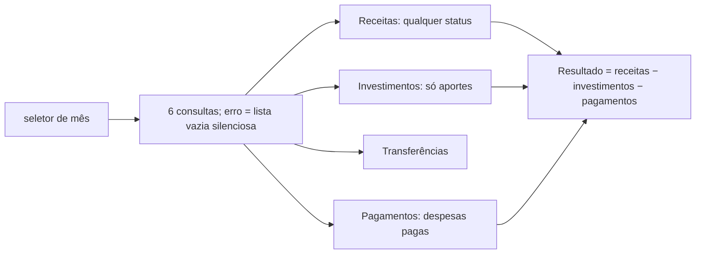

# DSH · 02 — Fluxos

## DSH-F1 — Carregar o Dashboard

Sequência em `dashboard.js:46-48`:

1. Sessão; em paralelo, RPC de acesso comercial para a faixa de teste (`:47`, falha silenciosa).
2. Workspace com `setup_completed`; cabeçalho "Olá, <primeiro nome>".
3. Janelas: mês atual e mês anterior, limites em UTC (`:48`, instrução 5).
4. Nove consultas em paralelo (`:48`, instrução 6).
5. Métricas do mês, só na moeda principal: receitas realizadas; despesas realizadas (por data de pagamento); investimentos = aportes + ajustes; transferências = valor de origem. Variação contra o mês anterior.
6. Patrimônio = saldo **inicial** das contas + valor das posições (moeda principal).
7. Rosca "Meu mês" com os quatro valores e "Total" = soma dos quatro.
8. Rosca de despesas por categoria (8 maiores; sem categoria = "Outros").
9. Evolução do patrimônio: um ponto por fechamento de investimento (soma dos `closing_value` na moeda principal), últimos 12 ou 24; sem fechamentos, um ponto com o patrimônio atual.
10. Objetivo rápido: falta, progresso, previsão = data inicial + anos.
11. Frase "Seu mês registra…".

## DSH-F2 — Visão gerencial (Consolidação Financeira)

Sequência em `dashboard-movements.js` (funções `load`, `addMonthOptions`, `refresh`):

1. Sessão e workspace; seletor com o mês atual e os 11 anteriores; mês inicial por `?month=AAAA-MM` ou o atual.
2. Ao escolher o mês: seis consultas (receitas por data de recebimento, transferências, despesas por data de pagamento, lançamentos de investimento, nomes de contas e de investimentos). Erros são engolidos: a tela mostra o que conseguiu e avisa só no console (`safe`, "Consolidação parcial").
3. Listas: Receitas (todas com data, qualquer status), Investimentos (só aportes), Transferências, Pagamentos (despesas com data de pagamento).
4. Totais só na moeda principal; "Saídas econômicas" = investimentos + pagamentos; "Resultado" = receitas − investimentos − pagamentos (transferências fora).
5. Contagem de movimentações = soma das quatro listas.

## DSH-F3 — Comparação dos mesmos dados nas duas telas

Conferido em `homologacao/scripts/etapa5/visao-gerencial.js` com um mês de exemplo (receitas: 5.000 recebida, 1.000 planejada, 300 cancelada, 900 em EUR; despesas: 3.000 paga, 400 prevista; investimentos: aporte 1.500, ajuste 200, resgate 700; transferência 500):

| Número | Dashboard | Visão gerencial | Por quê |
|---|---|---|---|
| Receitas | 5.000 | 6.300 | a Visão gerencial não filtra status (RN-DSH-012) |
| Despesas / Pagamentos | 3.000 | 3.000 | ambas por data de pagamento |
| Investimentos | 1.700 | 1.500 | dashboard soma ajustes; Visão gerencial só aportes (RN-DSH-013) |
| Transferências | 500 | 500 | valor de origem na moeda principal |
| Resgate de 700 | não aparece | não aparece | nenhuma tela mostra resgates |
| Receita em EUR | fora | na lista, fora do total | só moeda principal nos totais |
