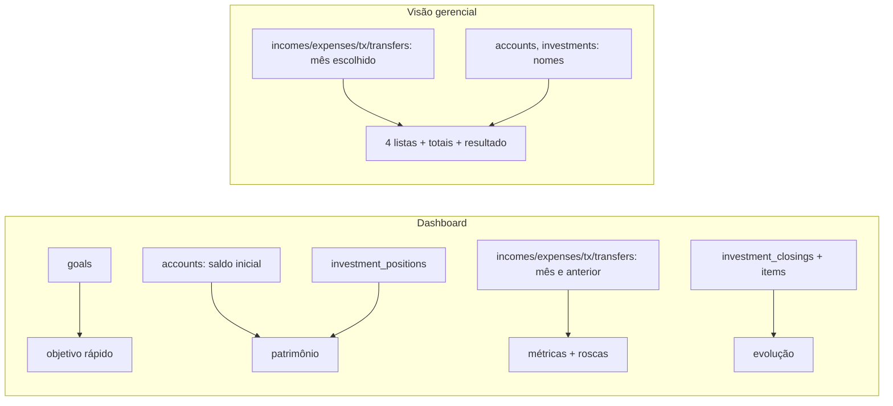

# DSH · 06 — Modelo de dados do módulo

O módulo não tem tabelas próprias; só lê. Colunas lidas e para quê:

| Fonte | Colunas | Dashboard | Visão gerencial |
|---|---|---|---|
| `goals` | `name, target_amount, target_years, start_date, initial_wealth, include_initial_wealth, created_at` | objetivo rápido (`initial_wealth` lido mas **não usado**: patrimônio ignora a opção, diferente do PLN) | — |
| `accounts` | `opening_balance, currency` / `id, name` | patrimônio | rótulo da conta |
| `incomes` | `amount, currency, status, receipt_date` / `+ id, description, category, account_id` | métricas (recebidas) | lista e total (qualquer status) |
| `expenses` | `amount, status, paid_date, planned_date, currency, category_id` / `+ id, description, account_id` | métricas e rosca (realizadas) | lista e total (com data de pagamento) |
| `investment_transactions` | `transaction_type, amount, currency, transaction_date` / `+ id, investment_id, description` | aportes + ajustes | só aportes |
| `transfers` | `source_amount, destination_amount, source_currency, destination_currency, transfer_date` / `+ ids, description` | valor de origem | lista com os dois valores; total pela origem |
| `investment_positions` | `investment_id, position_value, currency, valuation_status` | patrimônio (`valuation_status` lido, não usado) | — |
| `expense_categories` | `id, name` | nomes na rosca | — |
| `investment_closings` → `investment_closing_items` | `period_start`; `closing_value, currency` | evolução do patrimônio | — |
| `investments` | `id, name` | — | rótulo do aporte |

Observação sobre o dashboard: o objetivo rápido recebe `wealth` (saldo inicial + posições) e ignora `include_initial_wealth`/`initial_wealth`; o Planejamento respeita a opção. Para o mesmo usuário, "Patrimônio atual" pode ser diferente nas duas telas (RN-PLN-004 × RN-DSH-003).

