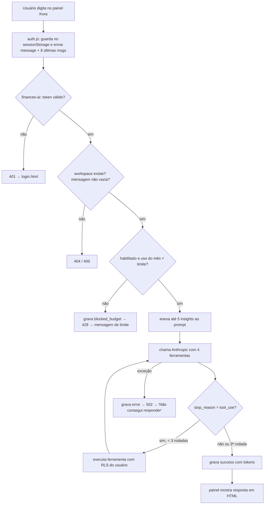
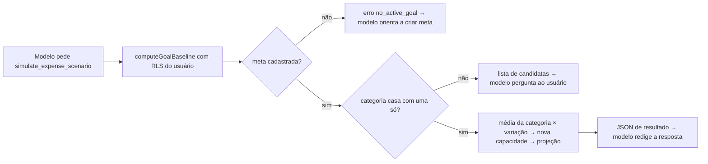
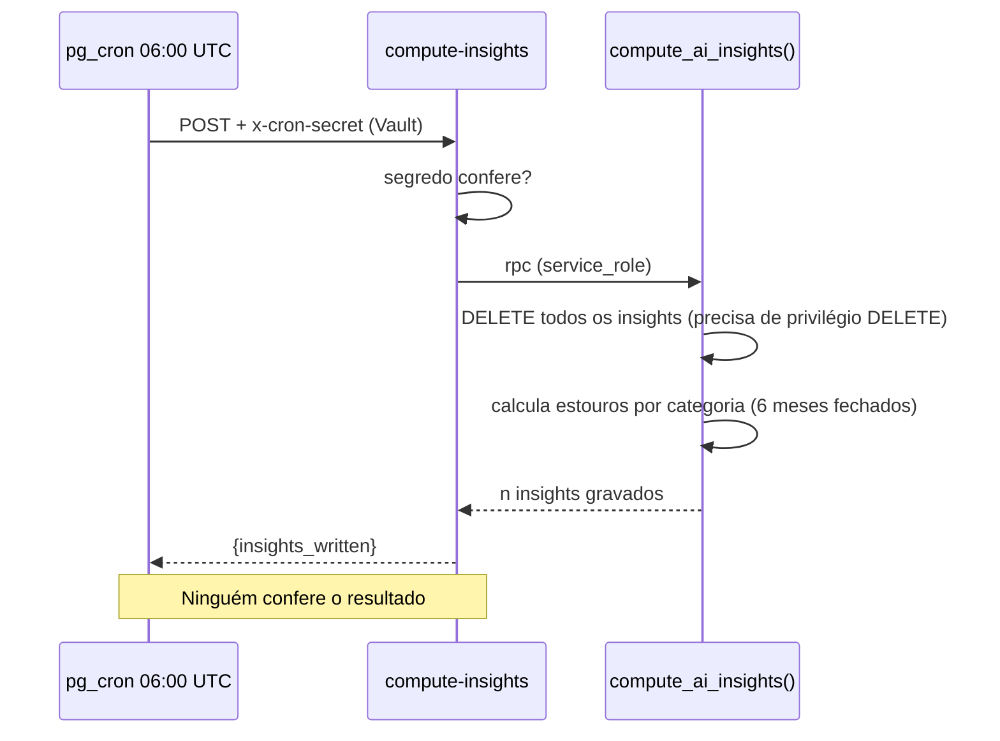

# IA · 02 — Fluxos

Regras citadas estão em `03-regras-de-negocio.md`; casos de teste em `08-plano-de-testes.md`.

## F1 — Conversar com a Kora

**Objetivo:** o usuário faz uma pergunta no painel e recebe uma resposta do modelo de IA.
**Escopo:** qualquer página logada com menu lateral (26 páginas); fora de `billing.html` e `finances-admin.html`.
**Regras:** RN-IA-001 a 007, 012 a 016, 034 a 036.
**Casos de teste:** CT-IA-01 a 07.

Etapas:
1. `auth.js` injeta o botão "✦ Kora" e o painel escondido (`auth.js:185-194`); carrega o histórico de exibição do `sessionStorage` e redesenha as bolhas (`:201, 211`).
2. O usuário digita e envia. A pergunta entra no histórico (máx. 40 mensagens) e aparece na tela; o campo é travado e aparece "···" (`:229-237`).
3. O painel monta `history` = últimas 8 mensagens completas (descarta uma pergunta sem resposta no fim) e chama a edge function `finances-ai` com `{message, history}` (`:239-244`).
4. A função exige o cabeçalho `Authorization`, valida o usuário no Supabase Auth e localiza o workspace (`index.ts:618-637`); valida o corpo (`:639-648`); refaz a limpeza do histórico (`:644, 158-175`).
5. Verifica o limite mensal (F2). Se bloqueado, devolve 429 `ai_limit_exceeded`.
6. Lê até 5 insights ativos e anexa ao prompt do sistema (`:686-697`).
7. Chama a Anthropic com o prompt, as 4 ferramentas e as mensagens; se o modelo pedir ferramenta, executa (F3) e repete, até 3 rodadas (`:707-748`).
8. Grava `ai_usage_log` com status `success`, tokens e latência; devolve `{answer}` (`:750-760`).
9. O painel mostra a resposta convertida de Markdown para HTML (negrito, listas, tabelas) e guarda no histórico (`auth.js:257-260, 133-173`).
10. Erro: 401 → vai para `login.html`; `ai_limit_exceeded` → "Você atingiu o limite de perguntas deste mês. Volta no próximo ciclo."; qualquer outro → "Não consegui responder agora. Tenta de novo?" (`auth.js:246-256`).

## F2 — Controle do limite mensal de perguntas

**Objetivo:** impedir que um workspace ultrapasse o número de perguntas permitido no mês.
**Regras:** RN-IA-008 a 011, 033.
**Casos de teste:** CT-IA-08 a 11.

Etapas:
1. Lê `ai_workspace_limits` do workspace: `monthly_request_limit` (padrão 100 se não houver linha) e `enabled` (padrão sim) (`index.ts:657-663`).
2. Conta linhas de `ai_usage_log` do workspace com `status = 'success'` e `created_at ≥` primeiro dia do mês às 00:00 **UTC** (`:665-670, 184-189`).
3. Se desabilitado ou contagem ≥ limite: grava uma linha `blocked_budget` (que **não** conta para o limite) e responde 429 (`:672-680`).
4. Chamadas que terminam em erro (status `error`) também não contam (`:762-769`).
5. O administrador altera limite e habilitação em `finances-admin.html` (RN-ADM-004).

Conferido por script (`homologacao/scripts/etapa7/limite-mensal.py`): 99/100 permite; 100/100 bloqueia; limite 0 bloqueia sempre; desabilitado bloqueia; o contador zera às 21:00 do último dia do mês no horário de Brasília (00:00 UTC do dia 1).

## F3 — Uso das ferramentas de simulação

**Objetivo:** responder perguntas sobre a meta financeira com números do workspace.
**Regras:** RN-IA-017 a 029.
**Casos de teste:** CT-IA-12 a 16.

| Ferramenta | Exige meta? | Entrada | Saída |
|---|---|---|---|
| `simulate_expense_scenario` | sim | categoria (texto), variação % (negativa reduz), horizonte opcional | linha de base (capacidade, aporte necessário, projeção, alvo), cenário (média da categoria, nova capacidade, projeção, bate a meta?), delta |
| `compare_plan_vs_reality` | sim | horizonte opcional | plano (aporte, projeção, bate?), realidade (investido médio, projeção, bate?), aporte necessário, alvo |
| `get_goal_status` | sim | — | nome, alvo, patrimônio atual, restante, % progresso, prazo |
| `project_future_balance` | não | horizonte obrigatório | patrimônio atual, capacidade, horizonte, projeção com taxa 0 |

Etapas (cenário de despesa):
1. O modelo decide chamar a ferramenta com a categoria que o usuário citou (`index.ts:84-87`).
2. `computeGoalBaseline` lê, com o token do usuário (RLS), moeda principal, meta mais recente, plano mais recente, contas, posições, categorias, despesas, receitas e lançamentos de investimento dos últimos 6 meses (`:390-443`).
3. Sem meta → `{"error":"no_active_goal"}`; o prompt manda explicar que é preciso cadastrar uma meta em Planejamento (`:450, 67-69`).
4. Casa a categoria: igual (sem acento/caixa) → usa; várias parecidas ou nenhuma → devolve a lista de candidatas e o prompt manda **perguntar** ao usuário em vez de escolher (`:243-261, 62-66`).
5. Média mensal da categoria (6 meses realizados ÷ 6) × (−variação %) = valor liberado por mês; nova capacidade; projeção com a taxa do plano (`:514-519`).
6. O resultado volta ao modelo em JSON (`:740-744`), que escreve a resposta em português.

Conferido por script (`homologacao/scripts/etapa7/simulacao-de-cenario.py`): capacidade 1.800; patrimônio 11.500; aporte necessário 1.475; cortar 20 % de uma categoria com média 800 libera 160/mês → projeção sobe de 119.500 para 129.100 em 60 meses (taxa 0), delta 9.600. As fórmulas são as mesmas do Planejamento, inclusive o defeito do patrimônio por saldo inicial (RN-PLN-004).

## F4 — Insights noturnos (categoria acima da média)

**Objetivo:** calcular, uma vez por dia, frases sobre categorias que vêm gastando acima da própria média, para enriquecer o contexto da Kora.
**Regras:** RN-IA-030 a 032.
**Casos de teste:** CT-IA-17 a 20.

Etapas:
1. 06:00 UTC: o pg_cron executa `net.http_post` para `/functions/v1/compute-insights` com o cabeçalho `x-cron-secret` lido do Vault (`20260914233500_...:17-30`).
2. A função compara o cabeçalho com `CRON_SECRET`; diferente → 401 (`compute-insights/index.ts:32-33`).
3. Chama `finances.compute_ai_insights()` com `service_role` (`:35-36`).
4. A função SQL **apaga todos os insights de todos os workspaces** (`20260914233000_...:58`), soma despesas realizadas por categoria e mês (só moeda principal, só meses fechados, últimos 6), exige ≥ 4 meses de dados, marca "estouro" quando o mês fica acima da média dos outros meses + max(desvio, 30 % da média), e grava um insight quando há ≥ 3 estouros **e** o último mês fechado estourou (`:60-122`).
5. Grava a frase em português com nome da categoria, média e último mês; validade 2 dias (`:123-147`). Devolve a contagem (`:149-150`).
6. Ninguém lê o retorno; não há alerta de falha.

Conferido por script (`homologacao/scripts/etapa7/regra-dos-insights.py`): dos 6 cenários, só "três estouros alternados com o último mês estourando" gera insight; subida recente (2 meses), pico único e três estouros antigos não geram; menos de 4 meses não avalia.

## F5 — Administrar o limite (referência)

Descrito no módulo ADM (F1 "Consumo de IA"): lista por workspace com uso do mês (UTC), alerta a 80 %, edição de limite (≥ 0) e habilitação (`20260915190000_...:46-106`).
