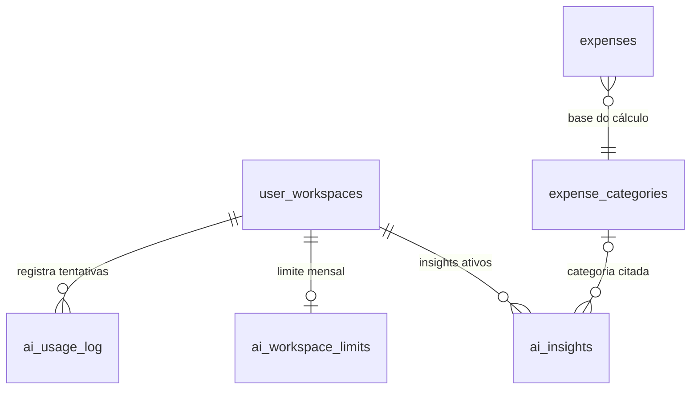

# IA · 06 — Modelo de dados

## Tabelas

### `finances.ai_usage_log` (DDL em `20260914160000_ai_usage_log.sql:11-27`)

| Coluna | Tipo | Regra | Uso |
|---|---|---|---|
| `id` | uuid | PK, gerado | |
| `workspace_id` | uuid | NOT NULL, FK `user_workspaces` | contagem do limite |
| `created_at` | timestamptz | padrão `now()` | janela mensal UTC |
| `feature` | text | padrão `'chat'` | só `chat` hoje (`index.ts:675, 752, 764`) |
| `model` | text | | `claude-sonnet-5` |
| `input_tokens`, `output_tokens` | int | | só em `success` |
| `latency_ms` | int | | `success` e `error` |
| `status` | text | NOT NULL; valores usados: `success`, `error`, `blocked_budget` (comentário :20; sem CHECK) | limite conta só `success` |
| `error_message` | text | | só em `error` |

Índice `(workspace_id, created_at)` (:26-27). RLS ativo sem políticas (:24).

### `finances.ai_insights` (DDL em `20260914233000_ai_insights.sql:12-25`)

| Coluna | Tipo | Regra | Uso |
|---|---|---|---|
| `id` | uuid | PK | |
| `workspace_id` | uuid | NOT NULL, FK `user_workspaces` | |
| `insight_type` | text | NOT NULL; único valor gravado: `category_overrun` (:126) | |
| `category_id` | uuid | FK `expense_categories`, opcional | |
| `summary` | text | NOT NULL; frase em português (:128-137) | vai para o prompt |
| `data` | jsonb | `overrun_months`, `months_with_data`, `avg_monthly`, `last_month_total` (:138-143) | não lido por ninguém |
| `expires_at` | timestamptz | NOT NULL; `now() + 2 dias` (:144) | filtro `> now()` (`index.ts:690`) |
| `created_at` | timestamptz | padrão `now()` | ordenação (`index.ts:691`) |

Índice `(workspace_id, expires_at)` (:25). RLS ativo sem políticas (:23). FK para `expense_categories` sem `ON DELETE`: **Inferência:** apagar uma categoria com insight ativo falha até o próximo recálculo (Ponto para validar; ver RDP).

### `finances.ai_workspace_limits` (DDL **fora** do repositório)

Colunas inferidas de `20260915190000_...:98-104` e `index.ts:657-663`:

| Coluna | Tipo (inferido) | Regra |
|---|---|---|
| `workspace_id` | uuid | chave (há `on conflict (workspace_id)`) |
| `monthly_request_limit` | int | ≥ 0 validado na RPC; padrão de leitura 100 quando não há linha |
| `enabled` | boolean | padrão de leitura `true` |
| `updated_by` | uuid | `auth.uid()` do admin |
| `updated_at` | timestamptz | |

## Relações

## Leituras que as ferramentas fazem (com RLS do usuário)

| Tabela / visão | Colunas | Fonte |
|---|---|---|
| `user_workspaces` | `primary_currency` | `index.ts:409` |
| `goals` | `id, name, target_amount, target_years, start_date, include_initial_wealth, initial_wealth, created_at` | `index.ts:410-415` |
| `plans` | `goal_id, projected_monthly_contribution, projected_monthly_rate` | `index.ts:416-421` |
| `accounts` | `opening_balance, currency` | `index.ts:422` |
| visão `investment_positions` | `position_value, currency` | `index.ts:423` |
| `expense_categories` | `id, name` | `index.ts:424` |
| `expenses` | `amount, currency, status, paid_date, category_id` (6 meses) | `index.ts:425-430` |
| `incomes` | `amount, currency, status, receipt_date` (6 meses) | `index.ts:431-436` |
| `investment_transactions` | `amount, currency, transaction_type, transaction_date` (6 meses) | `index.ts:437-442` |

Nenhuma ferramenta usa a visão `account_balances` (saldo atual), daí o defeito RN-IA-019.

## O que falta no modelo

- Tabela de consentimento/aceite do uso de IA (REQ-IA-02).
- Registro de execução do job (data, `insights_written`, erro) para monitoramento (REQ-IA-08).
- CHECK em `ai_usage_log.status` e `ai_insights.insight_type`.
- Custo estimado por chamada (ou tabela de preços) para limitar por dinheiro (REQ-IA-06).
