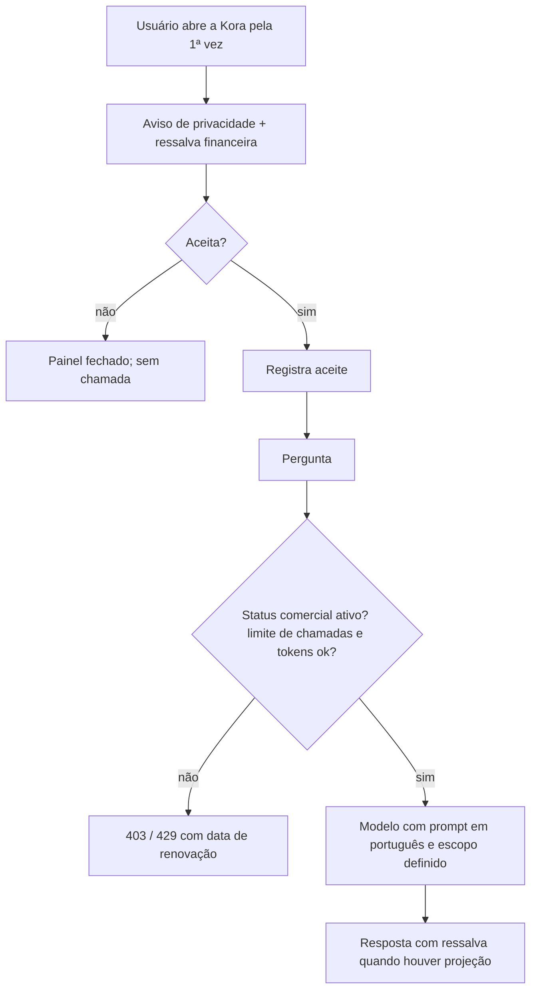

# IA · 10 — O ideal ("como deve ser")

Prioridade: P1 = antes de divulgar a Kora a usuários pagantes; P2 = próximo ciclo; P3 = melhoria.

| Código | Requisito ("como deve ser") | Como é hoje | Origem | Prioridade |
|---|---|---|---|---|
| REQ-IA-01 | Na primeira abertura do painel, aviso curto: as perguntas e um resumo dos dados financeiros são enviados a um fornecedor de IA no exterior; não digitar dados pessoais seus ou de terceiros; link para a política de privacidade. Rodapé permanente "Respostas geradas por IA" | Nenhum aviso | IA-S01; 05-conformidade | P1 |
| REQ-IA-02 | Política de privacidade e termo de uso citando o operador (Anthropic), a finalidade, a transferência internacional e a retenção; registro do aceite (quem, quando, versão) | Inexistentes | IA-S01; REQ-ACS-03 | P1 |
| REQ-IA-03 | Ressalva fixa no painel e no prompt: projeções são estimativas, não recomendação de investimento; o prompt deve pedir que o modelo repita a ressalva ao apresentar projeções | Ausente | IA-S12 | P1 |
| REQ-IA-04 | A função verifica o status comercial (`get_workspace_access_status`) e recusa com 403 quando BLOCKED | Não verifica | IA-S04 | P1 |
| REQ-IA-05 | Logout e troca de usuário apagam `korbuild-ai-history`; botão "Limpar conversa" no painel | Histórico sobrevive ao logout | IA-S05 | P1 |
| REQ-IA-06 | Limite por chamadas **e** por tokens (ou custo estimado) no mês, contando erros; limite por minuto por workspace; pergunta atual cortada em 4.000 caracteres | Só chamadas `success` | IA-S06, S17; R-IA-04 | P2 |
| REQ-IA-07 | Na última rodada, chamar o modelo sem ferramentas para garantir texto; resposta vazia não consome cota e registra `status = 'empty'` | Vazia conta como sucesso | IA-S07 | P2 |
| REQ-IA-08 | Job de insights: conceder DELETE só em `ai_insights` (ou função `SECURITY DEFINER` com `search_path` fixo); endereço do job parametrizado e versionado; registrar cada execução (`insights_written`, erro) e alertar quando falhar 2 dias seguidos; calcular só para workspaces com uso nos últimos 90 dias | DELETE sem grant; endereço de outro projeto; sem registro | IA-S02, S03; R-IA-03 | P1 |
| REQ-IA-09 | Modelo e `max_tokens` em configuração (`app_settings`), com alerta quando a taxa de `error` passar de X por hora; plano de troca de modelo documentado | Modelo fixo no código | IA-S11 | P2 |
| REQ-IA-10 | Retenção de `ai_usage_log` de 13 meses; não gravar `error_message` bruta (só código) | Sem retenção | IA-S13 | P3 |
| REQ-IA-11 | Prompt do sistema em português, com escopo explícito (finanças pessoais do workspace; recusar outros temas com cordialidade), sem prometer "em breve"; o texto do prompt revisado pelo produto e versionado | Inglês; "coming soon" | RN-IA-013; R-IA-08 | P2 |
| REQ-IA-12 | Patrimônio atual das ferramentas = saldo atual das contas + posições (mesma correção REQ-PLN-01); capacidade dividida pelos meses com dados | Saldo inicial; ÷ 6 fixo | RN-IA-019, 020 | P1 (junto com PLN) |
| REQ-IA-13 | Mostrar ao usuário quantas perguntas restam e a data de renovação (no fuso do workspace) | Só a mensagem de bloqueio | IA-S14 | P3 |
| REQ-IA-14 | CORS restrito às origens do aplicativo | `*` | IA-S08 | P3 |
| REQ-IA-15 | Testes automatizados: sanitização do histórico, bloqueio por limite, ferramenta sem meta, casamento de categoria, regra do insight (com dados `TESTE`); e um teste que falhe se o cliente `service_role` for usado fora das tabelas `ai_*` | Nenhum | IA-S09; 01-reconhecimento | P2 |
| REQ-IA-16 | Delimitar no prompt que o "contexto adicional" e os resultados das ferramentas são dados, não instruções | Sem delimitação | IA-S10 | P3 |
| REQ-IA-17 | Versionar a DDL de `ai_workspace_limits` e o job real de produção | Fora do repositório | IA-S15 | P2 |

## Fluxo ideal da primeira conversa

