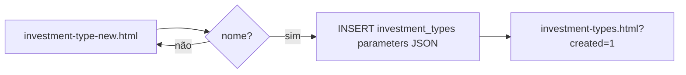
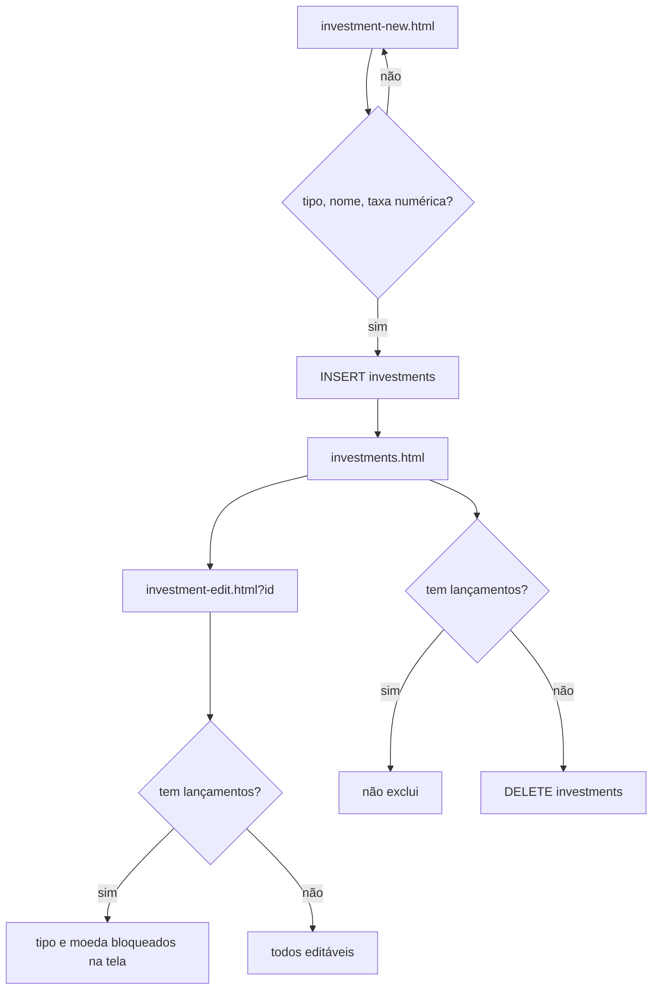
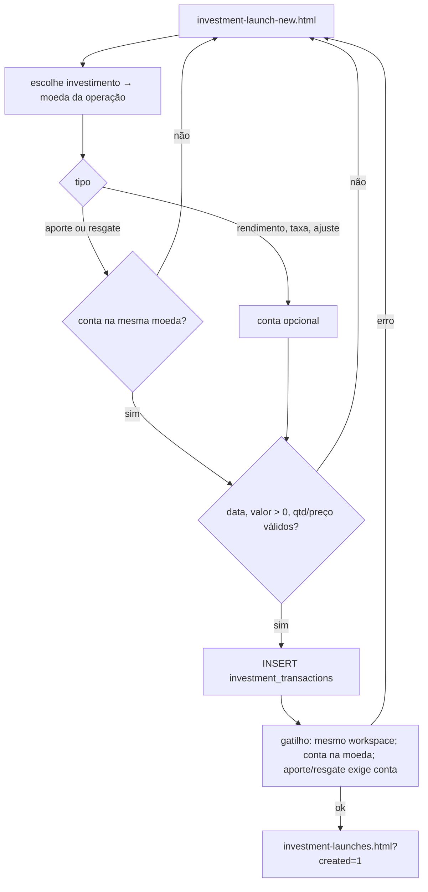
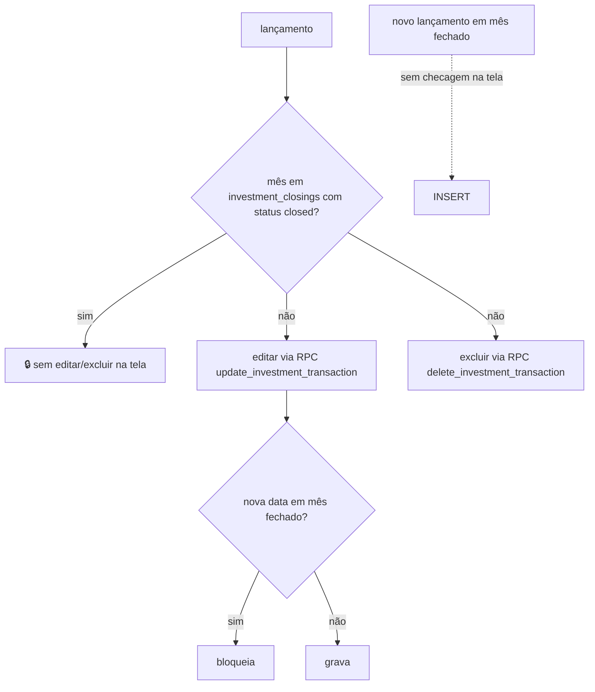

# INV · 02 — Fluxos

## INV-F1 — Cadastrar tipo de investimento

- **Objetivo:** definir como um grupo de investimentos terá a posição calculada.
- **Escopo:** `investment-type-new.html`, `investment-type-new.js`.
- **Etapas:** nome (obrigatório), descrição, método de posição (quantidade × preço; saldo acumulado; valor informado), quatro marcações (quantidade/cotas, preço de mercado, rendimentos, vencimento) → grava em `investment_types` com `is_system = false` e os parâmetros em JSON → lista.
- **Regras:** RN-INV-001 a 004. **Casos:** CT-INV-01 a 03.
- **Não existe:** editar ou excluir tipo.

## INV-F2 — Cadastrar, editar e excluir investimento

- **Cadastrar:** tipo, nome, código opcional, moeda (USD/BRL/EUR), taxa esperada ao mês (obrigatória) → `investments` com campos legados zerados (RN-INV-005 a 007, 010). Mensagem: "Investimento criado. Agora registre os movimentos em Lançamentos."
- **Editar:** nome e código sempre; tipo e moeda só sem lançamentos (RN-INV-008). Volta ao detalhe.
- **Excluir:** só sem lançamentos; com lançamentos, mensagem orienta a editar ou "futuramente, Arquivar" (RN-INV-009).
- **Casos:** CT-INV-04 a 12.

## INV-F3 — Carteira e posição

- **Carteira (`investments.html`):** lê `investment_positions` + ids com lançamentos; por linha: nome, tipo, quantidade, preço médio, valor atual ("Aguardando cotação" quando sem preço), resultado, rentabilidade; totais conforme RN-INV-012 (conferidos por script em `homologacao/scripts/etapa3/totais-da-carteira.js`).
- **Detalhe (`investment-detail.html`):** valor atual, investido (aportes − resgates), resultado, rentabilidade, quantidade, preço médio, preço atual, moeda; últimos 20 lançamentos com editar/excluir, ou cadeado quando o mês está fechado.
- **Como a posição é calculada:** fora do repositório (RN-INV-011). O modelo de referência (inferência) está em `homologacao/scripts/etapa3/modelo-de-posicao-referencia.py` para comparar no teste CT-INV-20.
- **Ponto crítico:** investimentos de tipo "preço de mercado" ficam para sempre em "Aguardando cotação", porque nada grava `current_price` (RN-INV-013).

## INV-F4 — Registrar lançamento

- **Escopo:** `investment-launch-new.html`, `investment-launch-new.js`, gatilho no banco.
- **Etapas:** escolhe investimento (pode vir pré-selecionado por `?investment=`); a tela mostra a moeda da operação e desabilita contas de outra moeda; tipo (aporte, resgate, rendimento, taxa, ajuste); conta obrigatória para aporte e resgate; data (padrão hoje UTC); valor > 0; quantidade e preço unitário opcionais; descrição → `INSERT` em `investment_transactions` na moeda do investimento → gatilho confere workspace, conta e moeda → lista.
- **Regras:** RN-INV-015 a 021, 026, 031. **Casos:** CT-INV-13 a 24.

## INV-F5 — Editar e excluir lançamento; período fechado

- **Editar:** abre `investment-launch-edit.html?id=`; se o mês do lançamento está fechado, o formulário é desabilitado; senão, altera tipo, data, valor, quantidade, preço, descrição pela RPC `update_investment_transaction`; ao salvar, se a **nova** data cair em mês fechado, bloqueia. Não permite trocar investimento nem conta (RN-INV-022, 023, 025).
- **Excluir:** nas três telas (detalhe, lista, edição), com confirmação "A posição será recalculada", pela RPC `delete_investment_transaction`, bloqueado na tela se o mês estiver fechado (RN-INV-024, 025).
- **Período fechado:** linha em `investment_closings` com `period_start` = 1º dia do mês e `status = 'closed'`. Quem fecha: ninguém pelo app (RN-INV-027).

