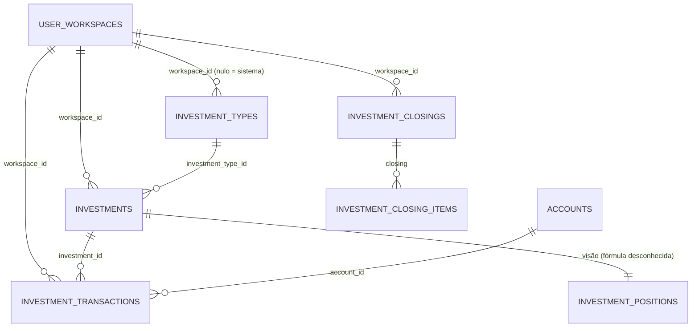

# INV · 06 — Modelo de dados do módulo

Só colunas que o código MOSTRA. Nenhuma das cinco tabelas tem DDL no repositório. Definição completa: **Ponto para validar** (T-BD-01).

## `finances.investment_types`

| Coluna | Tipo (inferido) | Uso | Fonte |
|---|---|---|---|
| `id` | uuid | chave | `investment-types.js:9` |
| `workspace_id` | uuid, **nulo para tipos do sistema** | dono | idem (`workspace_id.is.null`) |
| `name`, `description` | text | | `investment-type-new.js:9` |
| `is_system` | boolean | "Padrão do sistema" / "Personalizado" | idem |
| `parameters` | jsonb: `position_method` (`units_price` / `accumulated_balance` / `manual_value`), `quantity_enabled`, `market_price_enabled`, `income_enabled`, `maturity_enabled` | parâmetros do cálculo | idem |
| `created_at` | timestamptz | | `investment-types.js:9` |

## `finances.investments`

| Coluna | Tipo (inferido) | Uso | Fonte |
|---|---|---|---|
| `id`, `workspace_id` | uuid | | `investment-new.js:12` |
| `investment_type_id` | uuid → `investment_types` | tipo | idem |
| `name`, `symbol` | text | nome e código | idem |
| `currency` | text (código) | moeda da operação | idem |
| `invested_amount`, `current_value` | numeric, gravados 0 | legados, não atualizados | idem; RN-INV-006 |
| `quantity`, `avg_price`, `current_price` | numeric, gravados nulos | legados; `current_price` seria a cotação, nunca gravada | idem |
| `expected_monthly_rate` | numeric NOT NULL | taxa esperada % a.m. (Planejamento) | `20260927150000_...:6-7` |
| `updated_at` | timestamptz | gatilho `set_investments_updated_at` | `20260923191000_...:6` |

## `finances.investment_transactions`

| Coluna | Tipo (inferido) | Uso | Fonte |
|---|---|---|---|
| `id`, `workspace_id` | uuid | | `investment-launch-new.js:13` |
| `investment_id` | uuid → `investments` | | idem |
| `account_id` | uuid → `accounts`, nulo | conta da operação (FK criada em `20260912010000_...:110-112`) | idem |
| `transaction_type` | text: `contribution`, `withdrawal`, `income`, `fee`, `adjustment` | | idem |
| `transaction_date` | date | | idem |
| `quantity`, `unit_price` | numeric, nulos | | idem |
| `amount` | numeric > 0 (tela) | | idem |
| `currency` | text | copiada do investimento | idem |
| `description` | text, nulo | | idem |
| `created_at` | timestamptz | ordenação | `investment-launches.js:15` |

## `finances.investment_closings` e `finances.investment_closing_items`

| Tabela | Colunas conhecidas | Fonte |
|---|---|---|
| `investment_closings` | `id`, `workspace_id`, `period_start` (date, 1º dia do mês), `status` (`closed`, outros?) | `investment-launches.js:11`; `investment-detail.js:2` |
| `investment_closing_items` | `closing_value`, `currency` (ligado ao fechamento; **Inferência:** um item por investimento ou por moeda) | `dashboard.js:48` |

## Visão `finances.investment_positions` (fórmula fora do repositório)

Colunas lidas: `investment_id, workspace_id, investment_type_id, name, symbol, currency, quantity, cost_basis, contributions, withdrawals, income, fees, realized_gain, avg_price, current_price, position_value, valuation_status ('awaiting_price', …), result, return_pct, uses_market_price` (`investments.js:2`).

