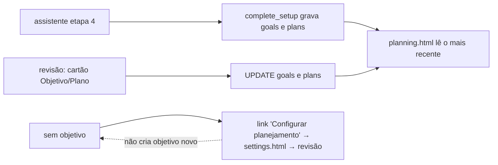
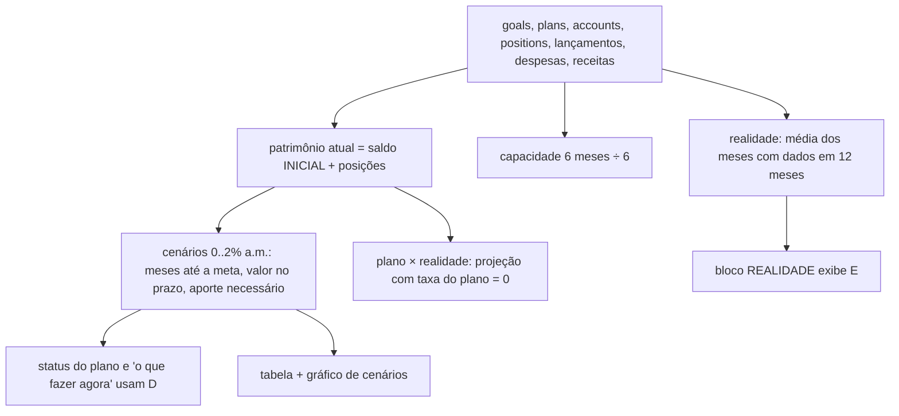

# PLN · 02 — Fluxos

## PLN-F1 — Definir e alterar objetivo e plano

- **Objetivo:** registrar a meta (nome, valor, prazo em anos, data inicial, patrimônio inicial considerado ou não) e o aporte mensal projetado.
- **Como é hoje:** só pelo assistente inicial (etapa 4) e pela revisão (`workspace.html?mode=review`, cartões "Objetivo" e "Plano"). Um objetivo e um plano por workspace na prática: as telas leem sempre o mais recente (`planning.js:131-132`). Não há tela para criar segundo objetivo, excluir, nem para alterar a taxa projetada (fica 0).
- **Regras:** RN-PLN-001 a 003; RN-ACS-021 a 025.
- **Ponto para validar:** workspace com configuração concluída e sem objetivo não consegue criar um (a revisão só atualiza se já existir, `app.js:109`); a tela mostra "Defina seu objetivo" com link para `settings.html`, que leva à revisão.

## PLN-F2 — Carregar a tela de Planejamento

Sequência em `planning.js:125-224`:

1. Sessão e workspace (precisa `setup_completed`).
2. Sete consultas em paralelo: objetivo, plano, contas (saldo inicial), posições, lançamentos de investimento, despesas e receitas dos últimos 12 meses (`:130-137`).
3. Sem objetivo → bloco "Defina seu objetivo" e para (`:140`).
4. **Patrimônio atual** (`:143`): se o objetivo considera patrimônio inicial, usa o valor declarado; senão, soma do **saldo inicial** das contas na moeda principal + valor das posições na moeda principal.
5. **Parâmetros do plano** (`:144`): aporte do plano, taxa do plano (0), prazo em meses = anos × 12 contados **a partir de hoje**, meta.
6. **Capacidade e investimento real** (`:145-146`): (receitas − despesas realizadas dos últimos 6 meses) ÷ 6; (aportes + ajustes dos últimos 6 meses) ÷ 6. Projeções pelo plano e pelo ritmo real; falta; progresso.
7. **Meu mês** (`:147`): receitas, despesas e investimentos realizados do mês corrente.
8. **Realidade** (`:150-158`): médias por mês com dados na janela de 12 meses (divisor = número de meses com dados).
9. **Cenários** (`:160-165`): para cada taxa (0 a 2 % a.m.), meses até a meta, valor no prazo, aporte necessário; classificação "alcança/não alcança" e "capacidade suficiente/insuficiente".
10. Tabela de cenários com opção de poder de compra e IR (`:168-191`); gráfico de cenários (`:192-198`); plano × realidade (`:199`); leitura do plano "O que fazer agora" (`:202-223`); gráfico plano × realidade (`:224`).

## PLN-F3 — Cenários de rendimento (cálculo)

Fórmulas em `planning.js:9-22`, conferidas em `homologacao/scripts/etapa4/projecao.js`:

- **Valor futuro:** patrimônio × (1+r)^n + aporte × ((1+r)^n − 1) ÷ r (aporte no fim de cada mês; com r = 0, aporte × n).
- **Aporte necessário:** (meta − patrimônio × (1+r)^n) × r ÷ ((1+r)^n − 1); com r = 0, (meta − patrimônio) ÷ n; 0 se a meta já foi alcançada ou o prazo é 0.
- **Meses até a meta:** log((meta + aporte/r) ÷ (patrimônio + aporte/r)) ÷ log(1+r); com r = 0, (meta − patrimônio) ÷ aporte; infinito sem aporte e sem patrimônio.

Exemplo conferido (patrimônio 10.000, aporte 1.000, meta 100.000, 60 meses):

| Taxa a.m. | ≈ a.a. | Valor no prazo | Aporte necessário | Meses até a meta |
|---|---|---|---|---|
| 0 % | 0 % | 70.000 | 1.500,00 | 90 |
| 0,5 % | 6,17 % | 83.258,53 | 1.239,95 | 71,5 |
| 1 % | 12,68 % | 99.836,64 | 1.002,00 | 60,1 |
| 1,5 % | 19,56 % | 120.646,85 | 785,41 | 52,2 |
| 2 % | 26,82 % | 146.861,85 | 589,12 | 46,3 |

Conta à mão para 1 %: 10.000 × 1,01^60 = 18.166,97; 1.000 × (1,01^60 − 1) ÷ 0,01 = 81.669,67; soma 99.836,64.

## PLN-F4 — Poder de compra e imposto (opção da tabela)

- Poder de compra hoje = valor no prazo ÷ (1 + inflação anual)^anos, com a inflação fixa por moeda (`planning.js:175, 180`).
- IR (só moeda BRL): dias = meses × 30; alíquota pela tabela regressiva; ganho = valor no prazo − patrimônio atual − aporte × meses; líquido = valor − ganho × alíquota (`planning.js:176, 183`).
- Conferido em `homologacao/scripts/etapa4/inflacao-ir.py`. Observações: 12 meses viram 360 dias (faixa de 20 %, quando 365 dias cairiam em 17,5 %); a alíquota incide sobre o ganho de todo o horizonte como se tudo fosse aplicado no início. A tela avisa "estimativa simplificada".

## PLN-F5 — Leitura do plano ("O que fazer agora")

Usa `capacity` (6 meses ÷ 6) contra o aporte necessário de cada cenário (`planning.js:163, 215-223`):

| Situação | Título | Destaque |
|---|---|---|
| sem aporte e sem patrimônio | "Adicione um aporte" | — |
| capacidade ≥ necessário em todos os cenários | "Continue e acompanhe" | margem no cenário 0 % |
| capacidade < necessário em todos | "O plano precisa de atenção" | falta no cenário 2 % |
| depende | "O resultado depende do rendimento" | falta no 0 % e sobra no 2 % |
