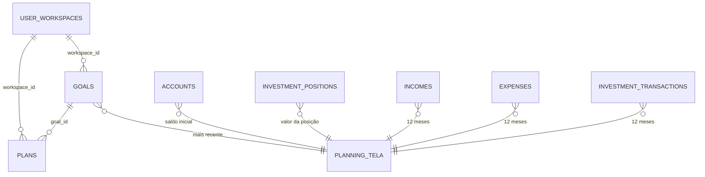

# PLN · 06 — Modelo de dados do módulo

Só colunas que o código MOSTRA. DDL fora do repositório: **Ponto para validar** (T-BD-01).

## `finances.goals`

| Coluna | Tipo (inferido) | Uso | Fonte |
|---|---|---|---|
| `id`, `workspace_id` | uuid | | `20260927120000_...:94` |
| `name` | text | nome do objetivo | idem |
| `target_amount` | numeric > 0 | meta | idem |
| `target_years` | integer 1-100 | prazo | idem |
| `start_date` | date | data inicial (usada só pelo dashboard) | idem; `dashboard.js` (`deadline`) |
| `include_initial_wealth` | boolean | considerar patrimônio declarado | idem |
| `initial_wealth` | numeric ≥ 0 | patrimônio declarado | idem |
| `created_at` | timestamptz | "mais recente" | `planning.js:131` |

## `finances.plans`

| Coluna | Tipo (inferido) | Uso | Fonte |
|---|---|---|---|
| `id`, `workspace_id` | uuid | | `20260927120000_...:97` |
| `goal_id` | uuid → `goals` | | idem |
| `projected_monthly_contribution` | numeric > 0 | aporte do plano | idem; `app.js:110` |
| `projected_monthly_rate` | numeric | taxa do plano; 0 desde 2026-09-12 (1,05 na 1ª versão) | `20260910030000_...:20`; `20260912010000_...:20` |
| `created_at` | timestamptz | "mais recente" | `planning.js:132` |

## Dados lidos de outros módulos

| Origem | Colunas | Uso |
|---|---|---|
| `accounts` | `opening_balance`, `currency` | patrimônio atual (saldo inicial) |
| `investment_positions` | `position_value`, `currency` | patrimônio atual |
| `investment_transactions` | `amount`, `currency`, `transaction_type`, `transaction_date` | investimento real (aportes + ajustes) |
| `incomes` | `amount`, `currency`, `status`, `receipt_date` | capacidade |
| `expenses` | `amount`, `currency`, `status`, `paid_date` | capacidade |
| `investments.expected_monthly_rate` | — | **não lida** |

