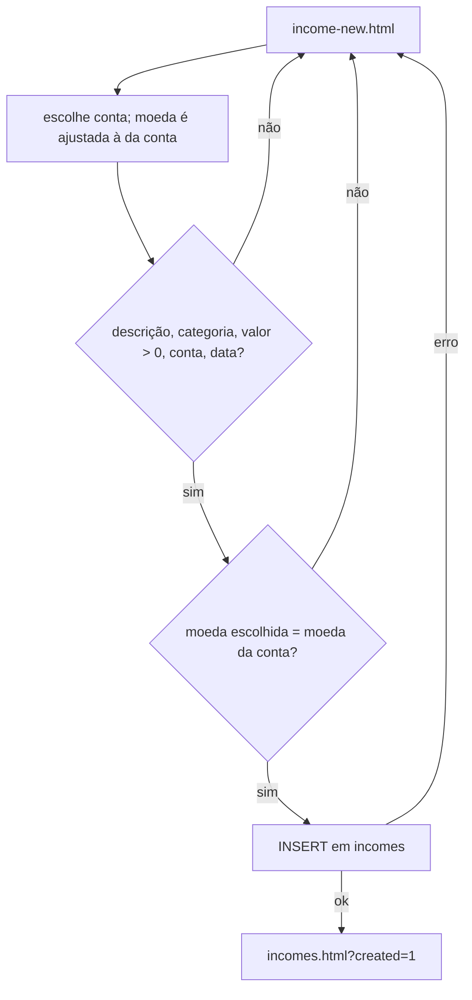
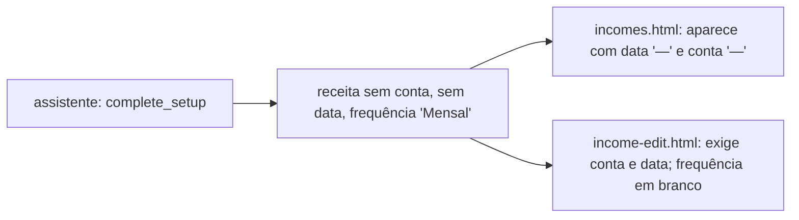
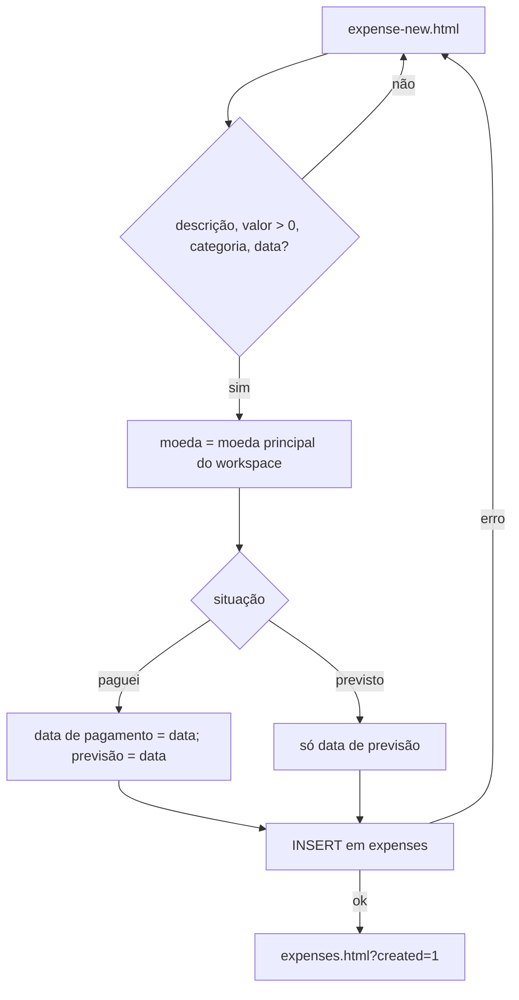

# RDP · 02 — Fluxos

## RDP-F1 — Registrar receita

- **Objetivo:** registrar uma entrada de dinheiro, realizada ou planejada.
- **Escopo:** `income-new.html`, `income-new.js`.
- **Etapas:** 1) escolhe a conta de recebimento (a moeda acompanha a conta); 2) descrição, categoria (texto livre), valor, data, frequência, status; 3) valida (RN-RDP-001, 002); 4) grava em `incomes`; 5) volta à lista.
- **Casos de teste:** CT-RDP-02 a 09.

## RDP-F2 — Editar ou excluir receita

- **Etapas:** abre `income-edit.html?id=`; carrega conta e receita do workspace; salva (mesmas validações) ou exclui após confirmação. Vindo da revisão do assistente, volta para ela.
- **Status disponíveis na edição:** recebida, planejada, cancelada.
- **Ponto de atenção:** a primeira receita do assistente tem outro formato (RDP-F3).

## RDP-F3 — A primeira receita criada pelo assistente

- **O que o código MOSTRA:** `complete_setup` grava a receita com descrição, categoria (rótulo da tela), valor, **moeda no formato de rótulo** ("USD — Dólar americano"), **frequência em português** ("Mensal", "Uma vez"), dia de recebimento, **sem conta e sem data** (`20260927120000_...:91-92`).
- **Efeito provável (Inferência, a confirmar no teste):** a receita não aparece em "Recebido este mês" (sem data), não entra no saldo de nenhuma conta (sem conta) e, ao abrir "Editar" pelo resumo do assistente, a frequência vem em branco (sem opção correspondente) e conta e data passam a ser obrigatórias.
- **Casos de teste:** CT-RDP-10 a 12.

## RDP-F4 — Registrar despesa

- **Objetivo:** registrar um gasto realizado ou previsto.
- **Escopo:** `expense-new.html`, `expense-new.js`.
- **Etapas:** 1) descrição, valor (texto), categoria, conta (opcional), situação (paguei ou previsto), data, tipo; 2) valida (RN-RDP-013); 3) se "paguei", a data vai para data de pagamento e de previsão; se previsto, só para previsão; 4) a moeda da despesa é a moeda principal do workspace; 5) grava.
- **Casos de teste:** CT-RDP-13 a 22.

## RDP-F5 — Editar ou excluir despesa

- **Etapas:** `expense-edit.html?id=` carrega a despesa e preenche; salva com a moeda original da despesa (não muda) ou exclui após confirmação. A lista também tem botão "Excluir". Texto da tela: período aberto; o bloqueio de períodos fechados não existe (RN-RDP-024).

## RDP-F6 — Totais do mês e despesas por categoria

- **Receitas** (`incomes.js:2`): "Recebido este mês" = receitas **realizadas** com data entre o início do mês e o início do próximo (limites em UTC); se houver mais de uma moeda, mostra "Múltiplas moedas". "Receitas cadastradas" = total de linhas; "Moedas" = quantidade de moedas.
- **Despesas** (`expenses.js:17-23`): "Este mês" = soma das realizadas do mês; "Previsto" = realizadas + previstas, sem canceladas; "Em aberto" = só previstas. Mês de referência de cada despesa = data de pagamento, ou a de previsão se não houver. Valores exibidos sempre em R$ (RN-RDP-017).
- **Por categoria** (`expenses.js:26-27`): só realizadas do mês, da maior para a menor, barra proporcional à maior.
- A janela do mês erra em Itália e Alemanha (todos os meses) e em Portugal e Reino Unido (abril a outubro): `homologacao/scripts/etapa2/limites-do-mes.js`. Em outubro, na Itália, "Recebido este mês" soma 200 em vez de 500 no exemplo de `receitas-do-mes.js`.
