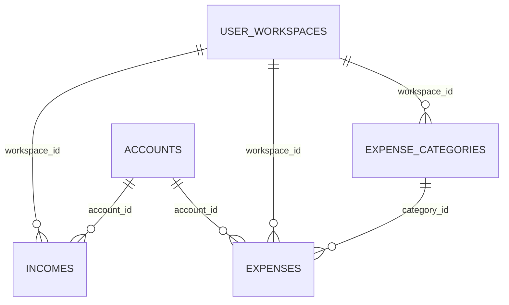

# RDP · 06 — Modelo de dados do módulo

Só colunas que o código MOSTRA. Definição completa: **Ponto para validar** (T-BD-01).

## `finances.incomes`

| Coluna | Tipo (inferido) | Uso | Fonte |
|---|---|---|---|
| `id`, `workspace_id` | uuid | chave e dono | `income-new.js:2` |
| `description`, `category` | text | texto livre | idem |
| `amount` | numeric (> 0) | valor | idem |
| `currency` | text | código ou rótulo | idem; `20260927120000_...:92` |
| `frequency` | text | `eventual`, `monthly`, `biweekly`, `weekly`, `yearly` nas telas; `Mensal`, `Quinzenal`, `Semanal`, `Anual`, `Uma vez` no assistente | `income-new.html`; `workspace.html:10` |
| `receipt_day` | integer, nulo | só o assistente grava; ninguém lê | RN-RDP-012 |
| `account_id` | uuid → `accounts`, nulo | conta de recebimento | `income-new.js:2` |
| `receipt_date` | date, nulo | data | idem |
| `status` | text | `realized`, `planned`, `canceled` | `incomes.js:2` |
| `created_at` | timestamptz | ordenação | idem |

## `finances.expenses`

| Coluna | Tipo (inferido) | Uso | Fonte |
|---|---|---|---|
| `id`, `workspace_id` | uuid | chave e dono | `expense-new.js:5` |
| `category_id` | uuid → `expense_categories` | categoria (obrigatória na tela) | idem |
| `account_id` | uuid → `accounts`, nulo | conta | idem |
| `description` | text | | idem |
| `expense_type` | text | `eventual`, `recurring`, `installment` | idem |
| `status` | text | `realized`, `planned`, `canceled` | idem |
| `amount` | numeric (≥ 0 no banco) | valor | idem |
| `currency` | text | moeda principal do workspace (rótulo) | idem |
| `planned_date`, `paid_date` | date, nulos | previsão e pagamento | idem |
| outras | — | a tela pede todas as colunas (`select('*')`) | `expenses.js:35` |

## `finances.expense_categories`

| Coluna | Tipo | Fonte |
|---|---|---|
| `id`, `workspace_id`, `name` | uuid, uuid, text | `tests/helpers/db.js:51-53`; `expenses.js:35` |

Ligada a `expenses.category_id` e `ai_insights.category_id` (`20260914233000_ai_insights.sql:16`).

## Vocabulários (resumo das inconsistências)

| Campo | Telas de receita/despesa | Assistente |
|---|---|---|
| Frequência | `eventual`, `monthly`… (inglês) | `Mensal`, `Uma vez`… (português) |
| Moeda da receita | código (`BRL`) | rótulo (`USD — Dólar americano`) |
| Moeda da despesa | rótulo da moeda principal | não cria despesa |
| Status | `realized`, `planned`, `canceled` | (não informado; presume-se `realized` por `app.js:61`) |

